# Topaz Gigapixel 模型依赖关系图 V0.2

生成日期：2026-08-20

## 1. 证据规则

- **FACT**：边只来自 JSON 的 `$.autoModel` 或 `$.backends.<backend>.scales.<scale>.nets[]`。
- **INFERENCE**：仅用于张量名可衔接但没有显式总编排的关系。
- `SELF_TEMPLATE_REFERENCE` 表示 net 名包含 `[N]`，由当前配置名模板化；不把它误标为外部辅助模型。
- `EXPLICIT_DEPENDENCY_REFERENCE` 表示配置明确引用了不同的固定资产名；其算法用途若无字段说明则保持 UNKNOWN。

## 2. 汇总

| 项目 | 数量 |
|---|---:|
| net 引用记录（含 backend/scale 重复） | 594 |
| 含 autoModel 的配置 | 12 |
| 引用 GCLC 的配置 | 13 |
| 引用 LDCLC 的配置 | 10 |

GCLC 配置来源：`gde.json`、`ggi.json`、`ggn.json`、`ggn_noee.json`、`ggnv2.json`、`ghc.json`、`ghq.json`、`ghq_noee.json`、`ghqv2.json`、`ghqv2_ldn.json`、`gmp.json`、`gmpv2.json`、`trf.json`

LDCLC 配置来源：`ldd21.json`、`lddv21.json`、`rxl_decoder0.json`、`ssddec0_0.json`、`ssddec0_5.json`、`ssddec1_0.json`、`tpn.json`、`tpn_900.json`、`tpn_900_nogpu.json`、`tpn_nogpu.json`

## 3. 配置级关系图

```mermaid
flowchart LR
  n_gde_json["gde.json"] -->|"autoModel"| n_gde_ap["gde_ap.json"]
  n_ggi_json["ggi.json"] -->|"autoModel"| n_gde_ap["gde_ap.json"]
  n_ggn_noee_json["ggn_noee.json"] -->|"autoModel"| n_ggn_ap["ggn_ap.json"]
  n_ggn_json["ggn.json"] -->|"autoModel"| n_ggn_ap["ggn_ap.json"]
  n_ggnv2_json["ggnv2.json"] -->|"autoModel"| n_ggn_ap["ggn_ap.json"]
  n_ghc_json["ghc.json"] -->|"autoModel"| n_ggn_ap["ggn_ap.json"]
  n_ghq_noee_json["ghq_noee.json"] -->|"autoModel"| n_ggn_ap["ggn_ap.json"]
  n_ghq_json["ghq.json"] -->|"autoModel"| n_ggn_ap["ggn_ap.json"]
  n_ghqv2_ldn_json["ghqv2_ldn.json"] -->|"autoModel"| n_ggn_ap["ggn_ap.json"]
  n_ghqv2_json["ghqv2.json"] -->|"autoModel"| n_ggn_ap["ggn_ap.json"]
  n_gmp_json["gmp.json"] -->|"autoModel"| n_ggn_ap["ggn_ap.json"]
  n_gmpv2_json["gmpv2.json"] -->|"autoModel"| n_ggn_ap["ggn_ap.json"]
  n_gde_json["gde.json"] -->|"nets reference"| GCLC["GCLC"]
  n_ggi_json["ggi.json"] -->|"nets reference"| GCLC["GCLC"]
  n_ggn_json["ggn.json"] -->|"nets reference"| GCLC["GCLC"]
  n_ggn_noee_json["ggn_noee.json"] -->|"nets reference"| GCLC["GCLC"]
  n_ggnv2_json["ggnv2.json"] -->|"nets reference"| GCLC["GCLC"]
  n_ghc_json["ghc.json"] -->|"nets reference"| GCLC["GCLC"]
  n_ghq_json["ghq.json"] -->|"nets reference"| GCLC["GCLC"]
  n_ghq_noee_json["ghq_noee.json"] -->|"nets reference"| GCLC["GCLC"]
  n_ghqv2_json["ghqv2.json"] -->|"nets reference"| GCLC["GCLC"]
  n_ghqv2_ldn_json["ghqv2_ldn.json"] -->|"nets reference"| GCLC["GCLC"]
  n_gmp_json["gmp.json"] -->|"nets reference"| GCLC["GCLC"]
  n_gmpv2_json["gmpv2.json"] -->|"nets reference"| GCLC["GCLC"]
  n_trf_json["trf.json"] -->|"nets reference"| GCLC["GCLC"]
  n_ldd21_json["ldd21.json"] -->|"nets reference"| LDCLC["LDCLC"]
  n_lddv21_json["lddv21.json"] -->|"nets reference"| LDCLC["LDCLC"]
  n_rxl_decoder0_json["rxl_decoder0.json"] -->|"nets reference"| LDCLC["LDCLC"]
  n_ssddec0_0_json["ssddec0_0.json"] -->|"nets reference"| LDCLC["LDCLC"]
  n_ssddec0_5_json["ssddec0_5.json"] -->|"nets reference"| LDCLC["LDCLC"]
  n_ssddec1_0_json["ssddec1_0.json"] -->|"nets reference"| LDCLC["LDCLC"]
  n_tpn_json["tpn.json"] -->|"nets reference"| LDCLC["LDCLC"]
  n_tpn_900_json["tpn_900.json"] -->|"nets reference"| LDCLC["LDCLC"]
  n_tpn_900_nogpu_json["tpn_900_nogpu.json"] -->|"nets reference"| LDCLC["LDCLC"]
  n_tpn_nogpu_json["tpn_nogpu.json"] -->|"nets reference"| LDCLC["LDCLC"]
```

该图只表示静态配置引用，不表示运行时一定执行，也不表示调用顺序。

## 4. 主模型与辅助引用 FACT

### 4.1 autoModel 显式关系

| 主配置 | shortName | 字段位置 | autoModel |
|---|---|---|---|
| gde.json | gde | $.autoModel | gde_ap |
| ggi.json | ggi | $.autoModel | gde_ap |
| ggn_noee.json | ggn_noee | $.autoModel | ggn_ap |
| ggn.json | ggn | $.autoModel | ggn_ap |
| ggnv2.json | ggnv2 | $.autoModel | ggn_ap |
| ghc.json | ghc | $.autoModel | ggn_ap |
| ghq_noee.json | ghq_noee | $.autoModel | ggn_ap |
| ghq.json | ghq | $.autoModel | ggn_ap |
| ghqv2_ldn.json | ghqv2_ldn | $.autoModel | ggn_ap |
| ghqv2.json | ghqv2 | $.autoModel | ggn_ap |
| gmp.json | gmp | $.autoModel | ggn_ap |
| gmpv2.json | gmpv2 | $.autoModel | ggn_ap |

### 4.2 全部 net 依赖边

下表完整保留每个 backend、scale、数组位置和 net 模式，不省略节点。

| 源配置 | shortName | backend | scale | net_index | net 原值 | 关系分类 |
|---|---|---|---:|---:|---|---|
| ap_all.json | ap_all | coreml | 1 | 0 | ggn_ap-v2-fp16-[H]x[W]-rev2-mlc.tz | EXPLICIT_DEPENDENCY_REFERENCE |
| ap_all.json | ap_all | coreml | 1 | 1 | apnb-v2-fp16-[H]x[W]-rev2-mlc.tz | EXPLICIT_DEPENDENCY_REFERENCE |
| ap_all.json | ap_all | coreml | 1 | 2 | slsp_ap-v2-fp16-[H]x[W]-rev2-mlc.tz | EXPLICIT_DEPENDENCY_REFERENCE |
| ap_all.json | ap_all | openvino | 1 | 0 | ggn_ap-v2-fp16-[H]x[W]-rev2-ox.tz2 | EXPLICIT_DEPENDENCY_REFERENCE |
| ap_all.json | ap_all | openvino | 1 | 1 | apnb-v2-fp16-[H]x[W]-rev2-ox.tz2 | EXPLICIT_DEPENDENCY_REFERENCE |
| ap_all.json | ap_all | openvino | 1 | 2 | slsp_ap-v2-fp16-[H]x[W]-rev2-ox.tz2 | EXPLICIT_DEPENDENCY_REFERENCE |
| ap_all.json | ap_all | onnx | 1 | 0 | ggn_ap-v2-fp16-[H]x[W]-rev2-ox.tz2 | EXPLICIT_DEPENDENCY_REFERENCE |
| ap_all.json | ap_all | onnx | 1 | 1 | apnb-v2-fp16-[H]x[W]-rev2-ox.tz2 | EXPLICIT_DEPENDENCY_REFERENCE |
| ap_all.json | ap_all | onnx | 1 | 2 | slsp_ap-v2-fp16-[H]x[W]-rev2-ox.tz2 | EXPLICIT_DEPENDENCY_REFERENCE |
| claa.json | claa | coreml | 1 | 0 | [N]-v[V]-fp32-[H]x[W]-rev1-mlc.tz | SELF_TEMPLATE_REFERENCE |
| claa.json | claa | onnx | 1 | 0 | [N]-v[V]-fp32-[H]x[W]-ox.tz2 | SELF_TEMPLATE_REFERENCE |
| claa.json | claa | openvino | 1 | 0 | [N]-v[V]-fp32-[H]x[W]-ov.tz2 | SELF_TEMPLATE_REFERENCE |
| gde_ap.json | gde_ap | coreml | 1 | 0 | [N]-v[V]-fp16-[H]x[W]-rev2-mlc.tz | SELF_TEMPLATE_REFERENCE |
| gde_ap.json | gde_ap | openvino | 1 | 0 | [N]-v[V]-fp16-[H]x[W]-rev2-ox.tz2 | SELF_TEMPLATE_REFERENCE |
| gde_ap.json | gde_ap | onnx | 1 | 0 | [N]-v[V]-fp16-[H]x[W]-rev2-ox.tz2 | SELF_TEMPLATE_REFERENCE |
| gde.json | gde | openvino | 1 | 0 | [N]-v[V]-fp32-[H]x[W]-[S]x-ov.tz2 | SELF_TEMPLATE_REFERENCE |
| gde.json | gde | openvino | 1 | 1 | gclc-v1-fp32-[H]x[W]-[S]x-ov.tz2 | GCLC_REFERENCE |
| gde.json | gde | openvino | 2 | 0 | [N]-v[V]-fp32-[H]x[W]-[S]x-ov.tz2 | SELF_TEMPLATE_REFERENCE |
| gde.json | gde | openvino | 2 | 1 | gclc-v1-fp32-[H]x[W]-[S]x-ov.tz2 | GCLC_REFERENCE |
| gde.json | gde | openvino | 4 | 0 | [N]-v[V]-fp32-[H]x[W]-[S]x-ov.tz2 | SELF_TEMPLATE_REFERENCE |
| gde.json | gde | openvino | 4 | 1 | gclc-v1-fp32-[H]x[W]-[S]x-ov.tz2 | GCLC_REFERENCE |
| gde.json | gde | openvino16 | 1 | 0 | [N]-v[V]-fp16-[H]x[W]-[S]x-ov.tz2 | SELF_TEMPLATE_REFERENCE |
| gde.json | gde | openvino16 | 1 | 1 | gclc-v1-fp16-[H]x[W]-[S]x-ov.tz2 | GCLC_REFERENCE |
| gde.json | gde | openvino16 | 2 | 0 | [N]-v[V]-fp16-[H]x[W]-[S]x-ov.tz2 | SELF_TEMPLATE_REFERENCE |
| gde.json | gde | openvino16 | 2 | 1 | gclc-v1-fp16-[H]x[W]-[S]x-ov.tz2 | GCLC_REFERENCE |
| gde.json | gde | openvino16 | 4 | 0 | [N]-v[V]-fp16-[H]x[W]-[S]x-ov.tz2 | SELF_TEMPLATE_REFERENCE |
| gde.json | gde | openvino16 | 4 | 1 | gclc-v1-fp16-[H]x[W]-[S]x-ov.tz2 | GCLC_REFERENCE |
| gde.json | gde | onnx | 1 | 0 | [N]-v2-fp32-[H]x[W]-[S]x-ox.tz2 | SELF_TEMPLATE_REFERENCE |
| gde.json | gde | onnx | 1 | 1 | gclc-v1-fp32-[H]x[W]-[S]x-ox.tz2 | GCLC_REFERENCE |
| gde.json | gde | onnx | 2 | 0 | [N]-v2-fp32-[H]x[W]-[S]x-ox.tz2 | SELF_TEMPLATE_REFERENCE |
| gde.json | gde | onnx | 2 | 1 | gclc-v1-fp32-[H]x[W]-[S]x-ox.tz2 | GCLC_REFERENCE |
| gde.json | gde | onnx | 4 | 0 | [N]-v2-fp32-[H]x[W]-[S]x-ox.tz2 | SELF_TEMPLATE_REFERENCE |
| gde.json | gde | onnx | 4 | 1 | gclc-v1-fp32-[H]x[W]-[S]x-ox.tz2 | GCLC_REFERENCE |
| gde.json | gde | onnx16 | 1 | 0 | [N]-v2-fp16-[H]x[W]-[S]x-ox.tz2 | SELF_TEMPLATE_REFERENCE |
| gde.json | gde | onnx16 | 1 | 1 | gclc-v1-fp32-[H]x[W]-[S]x-ox.tz2 | GCLC_REFERENCE |
| gde.json | gde | onnx16 | 2 | 0 | [N]-v2-fp16-[H]x[W]-[S]x-ox.tz2 | SELF_TEMPLATE_REFERENCE |
| gde.json | gde | onnx16 | 2 | 1 | gclc-v1-fp32-[H]x[W]-[S]x-ox.tz2 | GCLC_REFERENCE |
| gde.json | gde | onnx16 | 4 | 0 | [N]-v2-fp16-[H]x[W]-[S]x-ox.tz2 | SELF_TEMPLATE_REFERENCE |
| gde.json | gde | onnx16 | 4 | 1 | gclc-v1-fp32-[H]x[W]-[S]x-ox.tz2 | GCLC_REFERENCE |
| gde.json | gde | onnx_qnn | 1 | 0 | [N]-v2-fp16-[H]x[W]-[S]x-v73-qnn-ox.tz2 | SELF_TEMPLATE_REFERENCE |
| gde.json | gde | onnx_qnn | 1 | 1 | gclc-v1-fp32-[H]x[W]-[S]x-ox.tz2 | GCLC_REFERENCE |
| gde.json | gde | onnx_qnn | 2 | 0 | [N]-v2-fp16-[H]x[W]-[S]x-v73-qnn-ox.tz2 | SELF_TEMPLATE_REFERENCE |
| gde.json | gde | onnx_qnn | 2 | 1 | gclc-v1-fp32-[H]x[W]-[S]x-ox.tz2 | GCLC_REFERENCE |
| gde.json | gde | onnx_qnn | 4 | 0 | [N]-v2-fp16-[H]x[W]-[S]x-v73-qnn-ox.tz2 | SELF_TEMPLATE_REFERENCE |
| gde.json | gde | onnx_qnn | 4 | 1 | gclc-v1-fp32-[H]x[W]-[S]x-ox.tz2 | GCLC_REFERENCE |
| gde.json | gde | coreml | 1 | 0 | [N]-v[V]-fp16-[H]x[W]-[S]x-mlc.tz | SELF_TEMPLATE_REFERENCE |
| gde.json | gde | coreml | 1 | 1 | gclc-v1-fp16-[H]x[W]-[S]x-mlc.tz | GCLC_REFERENCE |
| gde.json | gde | coreml | 2 | 0 | [N]-v[V]-fp16-[H]x[W]-[S]x-mlc.tz | SELF_TEMPLATE_REFERENCE |
| gde.json | gde | coreml | 2 | 1 | gclc-v1-fp16-[H]x[W]-[S]x-mlc.tz | GCLC_REFERENCE |
| gde.json | gde | coreml | 4 | 0 | [N]-v[V]-fp16-[H]x[W]-[S]x-mlc.tz | SELF_TEMPLATE_REFERENCE |
| gde.json | gde | coreml | 4 | 1 | gclc-v1-fp16-[H]x[W]-[S]x-mlc.tz | GCLC_REFERENCE |
| gde.json | gde | tensorrt | 1 | 0 | [N]-v2-fp32-[H]x[W]-[S]x-rt[C]-rt.tz2 | SELF_TEMPLATE_REFERENCE |
| gde.json | gde | tensorrt | 1 | 1 | gclc-v1-fp32-[H]x[W]-[S]x-rt[C]-rt.tz2 | GCLC_REFERENCE |
| gde.json | gde | tensorrt | 2 | 0 | [N]-v2-fp32-[H]x[W]-[S]x-rt[C]-rt.tz2 | SELF_TEMPLATE_REFERENCE |
| gde.json | gde | tensorrt | 2 | 1 | gclc-v1-fp32-[H]x[W]-[S]x-rt[C]-rt.tz2 | GCLC_REFERENCE |
| gde.json | gde | tensorrt | 4 | 0 | [N]-v2-fp32-[H]x[W]-[S]x-rt[C]-rt.tz2 | SELF_TEMPLATE_REFERENCE |
| gde.json | gde | tensorrt | 4 | 1 | gclc-v1-fp32-[H]x[W]-[S]x-rt[C]-rt.tz2 | GCLC_REFERENCE |
| gffm.json | gffm | openvino | 1 | 0 | [N]-v[V]-fp32-[H]x[W]-ov.tz2 | SELF_TEMPLATE_REFERENCE |
| gffm.json | gffm | onnx_qnn | 1 | 0 | [N]-v[V]-fp16-[H]x[W]-qnn-ox.tz2 | SELF_TEMPLATE_REFERENCE |
| gffm.json | gffm | onnx | 1 | 0 | [N]-v[V]-fp32-[H]x[W]-ox.tz2 | SELF_TEMPLATE_REFERENCE |
| gffm.json | gffm | onnx16 | 1 | 0 | [N]-v[V]-fp16-[H]x[W]-rev2-ort.tz2 | SELF_TEMPLATE_REFERENCE |
| gffm.json | gffm | coreml | 1 | 0 | [N]-v[V]-fp16-[H]x[W]-rev2-mlc.tz | SELF_TEMPLATE_REFERENCE |
| gffm.json | gffm | tensorrt | 1 | 0 | [N]-v[V]-fp16-[H]x[W]-rev2-rt[C]-rt.tz2 | SELF_TEMPLATE_REFERENCE |
| gfg.json | gfg | openvino | 1 | 0 | [N]-v[V]-fp16-[H]x[W]-ov.tz2 | SELF_TEMPLATE_REFERENCE |
| gfg.json | gfg | onnx_qnn | 1 | 0 | [N]-v[V]-fp16-[H]x[W]-qnn-ox.tz2 | SELF_TEMPLATE_REFERENCE |
| gfg.json | gfg | onnx | 1 | 0 | [N]-v[V]-fp32-[H]x[W]-ox.tz2 | SELF_TEMPLATE_REFERENCE |
| gfg.json | gfg | coreml | 1 | 0 | [N]-v[V]-fp16-[H]x[W]-mlc.tz | SELF_TEMPLATE_REFERENCE |
| gfg.json | gfg | tensorrt | 1 | 0 | [N]-v[V]-fp32-[H]x[W]-rt[C]-rt.tz2 | SELF_TEMPLATE_REFERENCE |
| gfp-l.json | gfp-l | openvino | 1 | 0 | [N]-v[V]-fp32-[H]x[W]-ov.tz2 | SELF_TEMPLATE_REFERENCE |
| gfp-l.json | gfp-l | onnx_qnn | 1 | 0 | [N]-v[V]-fp16-[H]x[W]-qnn-ox.tz2 | SELF_TEMPLATE_REFERENCE |
| gfp-l.json | gfp-l | onnx | 1 | 0 | [N]-v[V]-fp32-[H]x[W]-ox.tz2 | SELF_TEMPLATE_REFERENCE |
| gfp-l.json | gfp-l | coreml | 1 | 0 | [N]-v[V]-fp32-[H]x[W]-mlc.tz | SELF_TEMPLATE_REFERENCE |
| gfp-l.json | gfp-l | tensorrt | 1 | 0 | [N]-v[V]-fp32-[H]x[W]-rt[C]-rt.tz2 | SELF_TEMPLATE_REFERENCE |
| gfp-s.json | gfp-s | openvino | 1 | 0 | [N]-v[V]-fp32-[H]x[W]-ov.tz2 | SELF_TEMPLATE_REFERENCE |
| gfp-s.json | gfp-s | onnx_qnn | 1 | 0 | [N]-v[V]-fp16-[H]x[W]-qnn-ox.tz2 | SELF_TEMPLATE_REFERENCE |
| gfp-s.json | gfp-s | onnx | 1 | 0 | [N]-v[V]-fp32-[H]x[W]-ox.tz2 | SELF_TEMPLATE_REFERENCE |
| gfp-s.json | gfp-s | coreml | 1 | 0 | [N]-v[V]-fp32-[H]x[W]-mlc.tz | SELF_TEMPLATE_REFERENCE |
| gfp-s.json | gfp-s | tensorrt | 1 | 0 | [N]-v[V]-fp32-[H]x[W]-rt[C]-rt.tz2 | SELF_TEMPLATE_REFERENCE |
| gfpf.json | gfpf | openvino | 1 | 0 | [N]-v[V]-fp16-[H]x[W]-ov.tz2 | SELF_TEMPLATE_REFERENCE |
| gfpf.json | gfpf | onnx_qnn | 1 | 0 | [N]-v[V]-fp16-[H]x[W]-qnn-ox.tz2 | SELF_TEMPLATE_REFERENCE |
| gfpf.json | gfpf | onnx | 1 | 0 | [N]-v[V]-fp32-[H]x[W]-ox.tz2 | SELF_TEMPLATE_REFERENCE |
| gfpf.json | gfpf | coreml | 1 | 0 | [N]-v[V]-fp16-[H]x[W]-mlc.tz | SELF_TEMPLATE_REFERENCE |
| gfpf.json | gfpf | tensorrt | 1 | 0 | [N]-v[V]-fp32-[H]x[W]-rt[C]-rt.tz2 | SELF_TEMPLATE_REFERENCE |
| gfrf.json | gfrf | openvino | 1 | 0 | [N]-v[V]-fp16-[H]x[W]-ov.tz2 | SELF_TEMPLATE_REFERENCE |
| gfrf.json | gfrf | onnx | 1 | 0 | [N]-v[V]-fp32-[H]x[W]-ox.tz2 | SELF_TEMPLATE_REFERENCE |
| gfrf.json | gfrf | coreml | 1 | 0 | [N]-v[V]-fp16-[H]x[W]-rev2-mlc.tz | SELF_TEMPLATE_REFERENCE |
| gfrf.json | gfrf | onnx16 | 1 | 0 | [N]-v[V]-fp16-[H]x[W]-rev2-ort.tz2 | SELF_TEMPLATE_REFERENCE |
| gfrf.json | gfrf | tensorrt | 1 | 0 | [N]-v[V]-fp16-[H]x[W]-rev2-rt[C]-rt.tz2 | SELF_TEMPLATE_REFERENCE |
| gfrg.json | gfrg | openvino | 1 | 0 | [N]-v[V]-fp16-[H]x[W]-ov.tz2 | SELF_TEMPLATE_REFERENCE |
| gfrg.json | gfrg | onnx_qnn | 1 | 0 | [N]-v[V]-fp32-[H]x[W]-ox.tz2 | SELF_TEMPLATE_REFERENCE |
| gfrg.json | gfrg | onnx | 1 | 0 | [N]-v[V]-fp32-[H]x[W]-ox.tz2 | SELF_TEMPLATE_REFERENCE |
| gfrg.json | gfrg | coreml | 1 | 0 | [N]-v[V]-fp32-[H]x[W]-rev1-mlc.tz | SELF_TEMPLATE_REFERENCE |
| gfrg.json | gfrg | tensorrt | 1 | 0 | [N]-v[V]-fp32-[H]x[W]-rt[C]-rt.tz2 | SELF_TEMPLATE_REFERENCE |
| ggi.json | ggi | openvino | 2 | 0 | [N]-v[V]-fp32-[H]x[W]-[S]x-ov.tz2 | SELF_TEMPLATE_REFERENCE |
| ggi.json | ggi | openvino | 2 | 1 | gclc-v1-fp32-[H]x[W]-[S]x-ov.tz2 | GCLC_REFERENCE |
| ggi.json | ggi | openvino | 4 | 0 | [N]-v[V]-fp32-[H]x[W]-[S]x-ov.tz2 | SELF_TEMPLATE_REFERENCE |
| ggi.json | ggi | openvino | 4 | 1 | gclc-v1-fp32-[H]x[W]-[S]x-ov.tz2 | GCLC_REFERENCE |
| ggi.json | ggi | openvino16 | 2 | 0 | [N]-v[V]-fp16-[H]x[W]-[S]x-ov.tz2 | SELF_TEMPLATE_REFERENCE |
| ggi.json | ggi | openvino16 | 2 | 1 | gclc-v1-fp16-[H]x[W]-[S]x-ov.tz2 | GCLC_REFERENCE |
| ggi.json | ggi | openvino16 | 4 | 0 | [N]-v[V]-fp16-[H]x[W]-[S]x-ov.tz2 | SELF_TEMPLATE_REFERENCE |
| ggi.json | ggi | openvino16 | 4 | 1 | gclc-v1-fp16-[H]x[W]-[S]x-ov.tz2 | GCLC_REFERENCE |
| ggi.json | ggi | onnx | 2 | 0 | [N]-v2-fp32-[H]x[W]-[S]x-ox.tz2 | SELF_TEMPLATE_REFERENCE |
| ggi.json | ggi | onnx | 2 | 1 | gclc-v1-fp32-[H]x[W]-[S]x-ox.tz2 | GCLC_REFERENCE |
| ggi.json | ggi | onnx | 4 | 0 | [N]-v2-fp32-[H]x[W]-[S]x-ox.tz2 | SELF_TEMPLATE_REFERENCE |
| ggi.json | ggi | onnx | 4 | 1 | gclc-v1-fp32-[H]x[W]-[S]x-ox.tz2 | GCLC_REFERENCE |
| ggi.json | ggi | onnx16 | 2 | 0 | [N]-v2-fp16-[H]x[W]-[S]x-ox.tz2 | SELF_TEMPLATE_REFERENCE |
| ggi.json | ggi | onnx16 | 2 | 1 | gclc-v1-fp32-[H]x[W]-[S]x-ox.tz2 | GCLC_REFERENCE |
| ggi.json | ggi | onnx16 | 4 | 0 | [N]-v2-fp16-[H]x[W]-[S]x-ox.tz2 | SELF_TEMPLATE_REFERENCE |
| ggi.json | ggi | onnx16 | 4 | 1 | gclc-v1-fp32-[H]x[W]-[S]x-ox.tz2 | GCLC_REFERENCE |
| ggi.json | ggi | onnx_qnn | 2 | 0 | [N]-v2-fp16-[H]x[W]-[S]x-v73-qnn-ox.tz2 | SELF_TEMPLATE_REFERENCE |
| ggi.json | ggi | onnx_qnn | 2 | 1 | gclc-v1-fp32-[H]x[W]-[S]x-ox.tz2 | GCLC_REFERENCE |
| ggi.json | ggi | onnx_qnn | 4 | 0 | [N]-v2-fp16-[H]x[W]-[S]x-v73-qnn-ox.tz2 | SELF_TEMPLATE_REFERENCE |
| ggi.json | ggi | onnx_qnn | 4 | 1 | gclc-v1-fp32-[H]x[W]-[S]x-ox.tz2 | GCLC_REFERENCE |
| ggi.json | ggi | coreml | 2 | 0 | [N]-v[V]-fp16-[H]x[W]-[S]x-mlc.tz | SELF_TEMPLATE_REFERENCE |
| ggi.json | ggi | coreml | 2 | 1 | gclc-v1-fp16-[H]x[W]-[S]x-mlc.tz | GCLC_REFERENCE |
| ggi.json | ggi | coreml | 4 | 0 | [N]-v[V]-fp16-[H]x[W]-[S]x-mlc.tz | SELF_TEMPLATE_REFERENCE |
| ggi.json | ggi | coreml | 4 | 1 | gclc-v1-fp16-[H]x[W]-[S]x-mlc.tz | GCLC_REFERENCE |
| ggi.json | ggi | tensorrt | 2 | 0 | [N]-v2-fp32-[H]x[W]-[S]x-rt[C]-rt.tz2 | SELF_TEMPLATE_REFERENCE |
| ggi.json | ggi | tensorrt | 2 | 1 | gclc-v1-fp32-[H]x[W]-[S]x-rt[C]-rt.tz2 | GCLC_REFERENCE |
| ggi.json | ggi | tensorrt | 4 | 0 | [N]-v2-fp32-[H]x[W]-[S]x-rt[C]-rt.tz2 | SELF_TEMPLATE_REFERENCE |
| ggi.json | ggi | tensorrt | 4 | 1 | gclc-v1-fp32-[H]x[W]-[S]x-rt[C]-rt.tz2 | GCLC_REFERENCE |
| ggn_ap.json | ggn_ap | coreml | 1 | 0 | [N]-v[V]-fp16-[H]x[W]-rev2-mlc.tz | SELF_TEMPLATE_REFERENCE |
| ggn_ap.json | ggn_ap | openvino | 1 | 0 | [N]-v[V]-fp16-[H]x[W]-rev2-ox.tz2 | SELF_TEMPLATE_REFERENCE |
| ggn_ap.json | ggn_ap | onnx | 1 | 0 | [N]-v[V]-fp16-[H]x[W]-rev2-ox.tz2 | SELF_TEMPLATE_REFERENCE |
| ggn_noee.json | ggn_noee | openvino | 2 | 0 | ggn-v[V]-fp16-[H]x[W]-[S]x-ov.tz2 | EXPLICIT_DEPENDENCY_REFERENCE |
| ggn_noee.json | ggn_noee | openvino | 2 | 1 | gclc-v1-fp16-[H]x[W]-[S]x-ov.tz2 | GCLC_REFERENCE |
| ggn_noee.json | ggn_noee | openvino | 4 | 0 | ggn-v[V]-fp16-[H]x[W]-[S]x-ov.tz2 | EXPLICIT_DEPENDENCY_REFERENCE |
| ggn_noee.json | ggn_noee | openvino | 4 | 1 | gclc-v1-fp16-[H]x[W]-[S]x-ov.tz2 | GCLC_REFERENCE |
| ggn_noee.json | ggn_noee | coreml | 2 | 0 | ggn-v[V]-fp16-[H]x[W]-[S]x-mlc.tz | EXPLICIT_DEPENDENCY_REFERENCE |
| ggn_noee.json | ggn_noee | coreml | 2 | 1 | gclc-v1-fp16-[H]x[W]-[S]x-mlc.tz | GCLC_REFERENCE |
| ggn_noee.json | ggn_noee | coreml | 4 | 0 | ggn-v[V]-fp16-[H]x[W]-[S]x-mlc.tz | EXPLICIT_DEPENDENCY_REFERENCE |
| ggn_noee.json | ggn_noee | coreml | 4 | 1 | gclc-v1-fp16-[H]x[W]-[S]x-mlc.tz | GCLC_REFERENCE |
| ggn.json | ggn | openvino | 2 | 0 | [N]-v[V]-fp16-[H]x[W]-[S]x-ov.tz2 | SELF_TEMPLATE_REFERENCE |
| ggn.json | ggn | openvino | 2 | 1 | gclc-v1-fp16-[H]x[W]-[S]x-ov.tz2 | GCLC_REFERENCE |
| ggn.json | ggn | openvino | 4 | 0 | [N]-v[V]-fp16-[H]x[W]-[S]x-ov.tz2 | SELF_TEMPLATE_REFERENCE |
| ggn.json | ggn | openvino | 4 | 1 | gclc-v1-fp16-[H]x[W]-[S]x-ov.tz2 | GCLC_REFERENCE |
| ggn.json | ggn | onnx16 | 2 | 0 | [N]-v[V]-fix-fp16-[H]x[W]-[S]x-ox.tz2 | SELF_TEMPLATE_REFERENCE |
| ggn.json | ggn | onnx16 | 2 | 1 | gclc-v1-fp32-[H]x[W]-[S]x-ox.tz2 | GCLC_REFERENCE |
| ggn.json | ggn | onnx16 | 4 | 0 | [N]-v[V]-fp16-[H]x[W]-[S]x-ox.tz2 | SELF_TEMPLATE_REFERENCE |
| ggn.json | ggn | onnx16 | 4 | 1 | gclc-v1-fp32-[H]x[W]-[S]x-ox.tz2 | GCLC_REFERENCE |
| ggn.json | ggn | onnx | 2 | 0 | [N]-v[V]-fp32-[H]x[W]-[S]x-ox.tz2 | SELF_TEMPLATE_REFERENCE |
| ggn.json | ggn | onnx | 2 | 1 | gclc-v1-fp32-[H]x[W]-[S]x-ox.tz2 | GCLC_REFERENCE |
| ggn.json | ggn | onnx | 4 | 0 | [N]-v[V]-fp32-[H]x[W]-[S]x-ox.tz2 | SELF_TEMPLATE_REFERENCE |
| ggn.json | ggn | onnx | 4 | 1 | gclc-v1-fp32-[H]x[W]-[S]x-ox.tz2 | GCLC_REFERENCE |
| ggn.json | ggn | onnx_qnn | 2 | 0 | [N]-v[V]-fp16-[H]x[W]-[S]x-v73-qnn-ox.tz2 | SELF_TEMPLATE_REFERENCE |
| ggn.json | ggn | onnx_qnn | 2 | 1 | gclc-v1-fp32-[H]x[W]-[S]x-ox.tz2 | GCLC_REFERENCE |
| ggn.json | ggn | onnx_qnn | 4 | 0 | [N]-v[V]-fp16-[H]x[W]-[S]x-v73-qnn-ox.tz2 | SELF_TEMPLATE_REFERENCE |
| ggn.json | ggn | onnx_qnn | 4 | 1 | gclc-v1-fp32-[H]x[W]-[S]x-ox.tz2 | GCLC_REFERENCE |
| ggn.json | ggn | coreml | 2 | 0 | [N]-v[V]-fp16-[H]x[W]-[S]x-mlc.tz | SELF_TEMPLATE_REFERENCE |
| ggn.json | ggn | coreml | 2 | 1 | gclc-v1-fp16-[H]x[W]-[S]x-mlc.tz | GCLC_REFERENCE |
| ggn.json | ggn | coreml | 4 | 0 | [N]-v[V]-fp16-[H]x[W]-[S]x-mlc.tz | SELF_TEMPLATE_REFERENCE |
| ggn.json | ggn | coreml | 4 | 1 | gclc-v1-fp16-[H]x[W]-[S]x-mlc.tz | GCLC_REFERENCE |
| ggn.json | ggn | tensorrt | 2 | 0 | [N]-v[V]-fp32-[H]x[W]-[S]x-rt[C]-rt.tz2 | SELF_TEMPLATE_REFERENCE |
| ggn.json | ggn | tensorrt | 2 | 1 | gclc-v1-fp32-[H]x[W]-[S]x-rt[C]-rt.tz2 | GCLC_REFERENCE |
| ggn.json | ggn | tensorrt | 4 | 0 | [N]-v[V]-fp32-[H]x[W]-[S]x-rt[C]-rt.tz2 | SELF_TEMPLATE_REFERENCE |
| ggn.json | ggn | tensorrt | 4 | 1 | gclc-v1-fp32-[H]x[W]-[S]x-rt[C]-rt.tz2 | GCLC_REFERENCE |
| ggnv2.json | ggnv2 | openvino | 2 | 0 | [N]-v[V]-fp16-[H]x[W]-[S]x-rev2-ov.tz2 | SELF_TEMPLATE_REFERENCE |
| ggnv2.json | ggnv2 | openvino | 2 | 1 | gclc-v1-fp16-[H]x[W]-[S]x-ov.tz2 | GCLC_REFERENCE |
| ggnv2.json | ggnv2 | openvino | 4 | 0 | [N]-v[V]-fp16-[H]x[W]-[S]x-rev2-ov.tz2 | SELF_TEMPLATE_REFERENCE |
| ggnv2.json | ggnv2 | openvino | 4 | 1 | gclc-v1-fp16-[H]x[W]-[S]x-ov.tz2 | GCLC_REFERENCE |
| ggnv2.json | ggnv2 | onnx16 | 2 | 0 | [N]-v[V]-fp16-[H]x[W]-[S]x-ox.tz2 | SELF_TEMPLATE_REFERENCE |
| ggnv2.json | ggnv2 | onnx16 | 2 | 1 | gclc-v1-fp32-[H]x[W]-[S]x-ox.tz2 | GCLC_REFERENCE |
| ggnv2.json | ggnv2 | onnx16 | 4 | 0 | [N]-v[V]-fp16-[H]x[W]-[S]x-ox.tz2 | SELF_TEMPLATE_REFERENCE |
| ggnv2.json | ggnv2 | onnx16 | 4 | 1 | gclc-v1-fp32-[H]x[W]-[S]x-ox.tz2 | GCLC_REFERENCE |
| ggnv2.json | ggnv2 | onnx | 2 | 0 | [N]-v[V]-fp32-[H]x[W]-[S]x-ox.tz2 | SELF_TEMPLATE_REFERENCE |
| ggnv2.json | ggnv2 | onnx | 2 | 1 | gclc-v1-fp32-[H]x[W]-[S]x-ox.tz2 | GCLC_REFERENCE |
| ggnv2.json | ggnv2 | onnx | 4 | 0 | [N]-v[V]-fp32-[H]x[W]-[S]x-ox.tz2 | SELF_TEMPLATE_REFERENCE |
| ggnv2.json | ggnv2 | onnx | 4 | 1 | gclc-v1-fp32-[H]x[W]-[S]x-ox.tz2 | GCLC_REFERENCE |
| ggnv2.json | ggnv2 | onnx_qnn | 2 | 0 | [N]-v[V]-fp16-[H]x[W]-[S]x-qnn-ox.tz2 | SELF_TEMPLATE_REFERENCE |
| ggnv2.json | ggnv2 | onnx_qnn | 2 | 1 | gclc-v1-fp32-[H]x[W]-[S]x-ox.tz2 | GCLC_REFERENCE |
| ggnv2.json | ggnv2 | onnx_qnn | 4 | 0 | [N]-v[V]-fp16-[H]x[W]-[S]x-qnn-ox.tz2 | SELF_TEMPLATE_REFERENCE |
| ggnv2.json | ggnv2 | onnx_qnn | 4 | 1 | gclc-v1-fp32-[H]x[W]-[S]x-ox.tz2 | GCLC_REFERENCE |
| ggnv2.json | ggnv2 | coreml | 2 | 0 | [N]-v[V]-fp16-[H]x[W]-[S]x-mlc.tz | SELF_TEMPLATE_REFERENCE |
| ggnv2.json | ggnv2 | coreml | 2 | 1 | gclc-v1-fp16-[H]x[W]-[S]x-mlc.tz | GCLC_REFERENCE |
| ggnv2.json | ggnv2 | coreml | 4 | 0 | [N]-v[V]-fp16-[H]x[W]-[S]x-mlc.tz | SELF_TEMPLATE_REFERENCE |
| ggnv2.json | ggnv2 | coreml | 4 | 1 | gclc-v1-fp16-[H]x[W]-[S]x-mlc.tz | GCLC_REFERENCE |
| ggnv2.json | ggnv2 | tensorrt | 2 | 0 | [N]-v[V]-fp32-[H]x[W]-[S]x-revx-rt[C]-rt.tz2 | SELF_TEMPLATE_REFERENCE |
| ggnv2.json | ggnv2 | tensorrt | 2 | 1 | gclc-v1-fp32-[H]x[W]-[S]x-rt[C]-rt.tz2 | GCLC_REFERENCE |
| ggnv2.json | ggnv2 | tensorrt | 4 | 0 | [N]-v[V]-fp32-[H]x[W]-[S]x-revx-rt[C]-rt.tz2 | SELF_TEMPLATE_REFERENCE |
| ggnv2.json | ggnv2 | tensorrt | 4 | 1 | gclc-v1-fp32-[H]x[W]-[S]x-rt[C]-rt.tz2 | GCLC_REFERENCE |
| ghc.json | ghc | openvino | 1 | 0 | [N]-v[V]-fp32-[H]x[W]-[S]x-ov.tz2 | SELF_TEMPLATE_REFERENCE |
| ghc.json | ghc | openvino | 1 | 1 | gclc-v1-fp32-[H]x[W]-[S]x-ov.tz2 | GCLC_REFERENCE |
| ghc.json | ghc | openvino | 2 | 0 | [N]-v[V]-fp32-[H]x[W]-[S]x-ov.tz2 | SELF_TEMPLATE_REFERENCE |
| ghc.json | ghc | openvino | 2 | 1 | gclc-v1-fp32-[H]x[W]-[S]x-ov.tz2 | GCLC_REFERENCE |
| ghc.json | ghc | openvino | 4 | 0 | [N]-v[V]-fp32-[H]x[W]-[S]x-ov.tz2 | SELF_TEMPLATE_REFERENCE |
| ghc.json | ghc | openvino | 4 | 1 | gclc-v1-fp32-[H]x[W]-[S]x-ov.tz2 | GCLC_REFERENCE |
| ghc.json | ghc | openvino16 | 1 | 0 | [N]-v[V]-fp16-[H]x[W]-[S]x-ov.tz2 | SELF_TEMPLATE_REFERENCE |
| ghc.json | ghc | openvino16 | 1 | 1 | gclc-v1-fp16-[H]x[W]-[S]x-ov.tz2 | GCLC_REFERENCE |
| ghc.json | ghc | openvino16 | 2 | 0 | [N]-v[V]-fp16-[H]x[W]-[S]x-ov.tz2 | SELF_TEMPLATE_REFERENCE |
| ghc.json | ghc | openvino16 | 2 | 1 | gclc-v1-fp16-[H]x[W]-[S]x-ov.tz2 | GCLC_REFERENCE |
| ghc.json | ghc | openvino16 | 4 | 0 | [N]-v[V]-fp16-[H]x[W]-[S]x-ov.tz2 | SELF_TEMPLATE_REFERENCE |
| ghc.json | ghc | openvino16 | 4 | 1 | gclc-v1-fp16-[H]x[W]-[S]x-ov.tz2 | GCLC_REFERENCE |
| ghc.json | ghc | onnx | 1 | 0 | [N]-v[V]-fp32-[H]x[W]-[S]x-ox.tz2 | SELF_TEMPLATE_REFERENCE |
| ghc.json | ghc | onnx | 1 | 1 | gclc-v1-fp32-[H]x[W]-[S]x-ox.tz2 | GCLC_REFERENCE |
| ghc.json | ghc | onnx | 2 | 0 | [N]-v[V]-fp32-[H]x[W]-[S]x-ox.tz2 | SELF_TEMPLATE_REFERENCE |
| ghc.json | ghc | onnx | 2 | 1 | gclc-v1-fp32-[H]x[W]-[S]x-ox.tz2 | GCLC_REFERENCE |
| ghc.json | ghc | onnx | 4 | 0 | [N]-v[V]-fp32-[H]x[W]-[S]x-ox.tz2 | SELF_TEMPLATE_REFERENCE |
| ghc.json | ghc | onnx | 4 | 1 | gclc-v1-fp32-[H]x[W]-[S]x-ox.tz2 | GCLC_REFERENCE |
| ghc.json | ghc | onnx16 | 1 | 0 | [N]-v[V]-fp16-[H]x[W]-[S]x-ox.tz2 | SELF_TEMPLATE_REFERENCE |
| ghc.json | ghc | onnx16 | 1 | 1 | gclc-v1-fp32-[H]x[W]-[S]x-ox.tz2 | GCLC_REFERENCE |
| ghc.json | ghc | onnx16 | 2 | 0 | [N]-v[V]-fp16-[H]x[W]-[S]x-ox.tz2 | SELF_TEMPLATE_REFERENCE |
| ghc.json | ghc | onnx16 | 2 | 1 | gclc-v1-fp32-[H]x[W]-[S]x-ox.tz2 | GCLC_REFERENCE |
| ghc.json | ghc | onnx16 | 4 | 0 | [N]-v[V]-fp16-[H]x[W]-[S]x-ox.tz2 | SELF_TEMPLATE_REFERENCE |
| ghc.json | ghc | onnx16 | 4 | 1 | gclc-v1-fp32-[H]x[W]-[S]x-ox.tz2 | GCLC_REFERENCE |
| ghc.json | ghc | onnx_qnn | 1 | 0 | [N]-v[V]-fp16-[H]x[W]-[S]x-qnn-ox.tz2 | SELF_TEMPLATE_REFERENCE |
| ghc.json | ghc | onnx_qnn | 1 | 1 | gclc-v1-fp32-[H]x[W]-[S]x-ox.tz2 | GCLC_REFERENCE |
| ghc.json | ghc | onnx_qnn | 2 | 0 | [N]-v[V]-fp16-[H]x[W]-[S]x-qnn-ox.tz2 | SELF_TEMPLATE_REFERENCE |
| ghc.json | ghc | onnx_qnn | 2 | 1 | gclc-v1-fp32-[H]x[W]-[S]x-ox.tz2 | GCLC_REFERENCE |
| ghc.json | ghc | onnx_qnn | 4 | 0 | [N]-v[V]-fp16-[H]x[W]-[S]x-qnn-ox.tz2 | SELF_TEMPLATE_REFERENCE |
| ghc.json | ghc | onnx_qnn | 4 | 1 | gclc-v1-fp32-[H]x[W]-[S]x-ox.tz2 | GCLC_REFERENCE |
| ghc.json | ghc | coreml | 1 | 0 | [N]-v[V]-fp32-[H]x[W]-[S]x-mlc.tz | SELF_TEMPLATE_REFERENCE |
| ghc.json | ghc | coreml | 1 | 1 | gclc-v1-fp32-[H]x[W]-[S]x-mlc.tz | GCLC_REFERENCE |
| ghc.json | ghc | coreml | 2 | 0 | [N]-v[V]-fp32-[H]x[W]-[S]x-mlc.tz | SELF_TEMPLATE_REFERENCE |
| ghc.json | ghc | coreml | 2 | 1 | gclc-v1-fp32-[H]x[W]-[S]x-mlc.tz | GCLC_REFERENCE |
| ghc.json | ghc | coreml | 4 | 0 | [N]-v[V]-fp32-[H]x[W]-[S]x-mlc.tz | SELF_TEMPLATE_REFERENCE |
| ghc.json | ghc | coreml | 4 | 1 | gclc-v1-fp32-[H]x[W]-[S]x-mlc.tz | GCLC_REFERENCE |
| ghc.json | ghc | tensorrt | 1 | 0 | [N]-v[V]-fp32-[H]x[W]-[S]x-rt[C]-rt.tz2 | SELF_TEMPLATE_REFERENCE |
| ghc.json | ghc | tensorrt | 1 | 1 | gclc-v1-fp32-[H]x[W]-[S]x-rt[C]-rt.tz2 | GCLC_REFERENCE |
| ghc.json | ghc | tensorrt | 2 | 0 | [N]-v[V]-fp32-[H]x[W]-[S]x-rt[C]-rt.tz2 | SELF_TEMPLATE_REFERENCE |
| ghc.json | ghc | tensorrt | 2 | 1 | gclc-v1-fp32-[H]x[W]-[S]x-rt[C]-rt.tz2 | GCLC_REFERENCE |
| ghc.json | ghc | tensorrt | 4 | 0 | [N]-v[V]-fp32-[H]x[W]-[S]x-rt[C]-rt.tz2 | SELF_TEMPLATE_REFERENCE |
| ghc.json | ghc | tensorrt | 4 | 1 | gclc-v1-fp32-[H]x[W]-[S]x-rt[C]-rt.tz2 | GCLC_REFERENCE |
| ghq_noee.json | ghq_noee | openvino | 2 | 0 | ghq-v[V]-fp16-[H]x[W]-[S]x-ov.tz2 | EXPLICIT_DEPENDENCY_REFERENCE |
| ghq_noee.json | ghq_noee | openvino | 2 | 1 | gclc-v1-fp16-[H]x[W]-[S]x-ov.tz2 | GCLC_REFERENCE |
| ghq_noee.json | ghq_noee | openvino | 4 | 0 | ghq-v[V]-fp16-[H]x[W]-[S]x-ov.tz2 | EXPLICIT_DEPENDENCY_REFERENCE |
| ghq_noee.json | ghq_noee | openvino | 4 | 1 | gclc-v1-fp16-[H]x[W]-[S]x-ov.tz2 | GCLC_REFERENCE |
| ghq_noee.json | ghq_noee | coreml | 2 | 0 | ghq-v[V]-fp16-[H]x[W]-[S]x-mlc.tz | EXPLICIT_DEPENDENCY_REFERENCE |
| ghq_noee.json | ghq_noee | coreml | 2 | 1 | gclc-v1-fp16-[H]x[W]-[S]x-mlc.tz | GCLC_REFERENCE |
| ghq_noee.json | ghq_noee | coreml | 4 | 0 | ghq-v[V]-fp16-[H]x[W]-[S]x-mlc.tz | EXPLICIT_DEPENDENCY_REFERENCE |
| ghq_noee.json | ghq_noee | coreml | 4 | 1 | gclc-v1-fp16-[H]x[W]-[S]x-mlc.tz | GCLC_REFERENCE |
| ghq.json | ghq | openvino | 2 | 0 | [N]-v[V]-fp16-[H]x[W]-[S]x-ov.tz2 | SELF_TEMPLATE_REFERENCE |
| ghq.json | ghq | openvino | 2 | 1 | gclc-v1-fp16-[H]x[W]-[S]x-ov.tz2 | GCLC_REFERENCE |
| ghq.json | ghq | openvino | 4 | 0 | [N]-v[V]-fp16-[H]x[W]-[S]x-ov.tz2 | SELF_TEMPLATE_REFERENCE |
| ghq.json | ghq | openvino | 4 | 1 | gclc-v1-fp16-[H]x[W]-[S]x-ov.tz2 | GCLC_REFERENCE |
| ghq.json | ghq | onnx16 | 2 | 0 | [N]-v[V]-fix-fp16-[H]x[W]-[S]x-ox.tz2 | SELF_TEMPLATE_REFERENCE |
| ghq.json | ghq | onnx16 | 2 | 1 | gclc-v1-fp32-[H]x[W]-[S]x-ox.tz2 | GCLC_REFERENCE |
| ghq.json | ghq | onnx16 | 4 | 0 | [N]-v[V]-fp16-[H]x[W]-[S]x-ox.tz2 | SELF_TEMPLATE_REFERENCE |
| ghq.json | ghq | onnx16 | 4 | 1 | gclc-v1-fp32-[H]x[W]-[S]x-ox.tz2 | GCLC_REFERENCE |
| ghq.json | ghq | onnx | 2 | 0 | [N]-v[V]-fp32-[H]x[W]-[S]x-ox.tz2 | SELF_TEMPLATE_REFERENCE |
| ghq.json | ghq | onnx | 2 | 1 | gclc-v1-fp32-[H]x[W]-[S]x-ox.tz2 | GCLC_REFERENCE |
| ghq.json | ghq | onnx | 4 | 0 | [N]-v[V]-fp32-[H]x[W]-[S]x-ox.tz2 | SELF_TEMPLATE_REFERENCE |
| ghq.json | ghq | onnx | 4 | 1 | gclc-v1-fp32-[H]x[W]-[S]x-ox.tz2 | GCLC_REFERENCE |
| ghq.json | ghq | onnx_qnn | 2 | 0 | [N]-v[V]-fp16-[H]x[W]-[S]x-v73-qnn-ox.tz2 | SELF_TEMPLATE_REFERENCE |
| ghq.json | ghq | onnx_qnn | 2 | 1 | gclc-v1-fp32-[H]x[W]-[S]x-ox.tz2 | GCLC_REFERENCE |
| ghq.json | ghq | onnx_qnn | 4 | 0 | [N]-v[V]-fp16-[H]x[W]-[S]x-v73-qnn-ox.tz2 | SELF_TEMPLATE_REFERENCE |
| ghq.json | ghq | onnx_qnn | 4 | 1 | gclc-v1-fp32-[H]x[W]-[S]x-ox.tz2 | GCLC_REFERENCE |
| ghq.json | ghq | coreml | 2 | 0 | [N]-v[V]-fp16-[H]x[W]-[S]x-mlc.tz | SELF_TEMPLATE_REFERENCE |
| ghq.json | ghq | coreml | 2 | 1 | gclc-v1-fp16-[H]x[W]-[S]x-mlc.tz | GCLC_REFERENCE |
| ghq.json | ghq | coreml | 4 | 0 | [N]-v[V]-fp16-[H]x[W]-[S]x-mlc.tz | SELF_TEMPLATE_REFERENCE |
| ghq.json | ghq | coreml | 4 | 1 | gclc-v1-fp16-[H]x[W]-[S]x-mlc.tz | GCLC_REFERENCE |
| ghq.json | ghq | tensorrt | 2 | 0 | [N]-v[V]-fp32-[H]x[W]-[S]x-rt[C]-rt.tz2 | SELF_TEMPLATE_REFERENCE |
| ghq.json | ghq | tensorrt | 2 | 1 | gclc-v1-fp32-[H]x[W]-[S]x-rt[C]-rt.tz2 | GCLC_REFERENCE |
| ghq.json | ghq | tensorrt | 4 | 0 | [N]-v[V]-fp32-[H]x[W]-[S]x-rt[C]-rt.tz2 | SELF_TEMPLATE_REFERENCE |
| ghq.json | ghq | tensorrt | 4 | 1 | gclc-v1-fp32-[H]x[W]-[S]x-rt[C]-rt.tz2 | GCLC_REFERENCE |
| ghqv2_ldn.json | ghqv2_ldn | openvino | 2 | 0 | [N]-v[V]-fp16-[H]x[W]-[S]x-rev2-ov.tz2 | SELF_TEMPLATE_REFERENCE |
| ghqv2_ldn.json | ghqv2_ldn | openvino | 2 | 1 | gclc-v1-fp16-[H]x[W]-[S]x-ov.tz2 | GCLC_REFERENCE |
| ghqv2_ldn.json | ghqv2_ldn | openvino | 4 | 0 | [N]-v[V]-fp16-[H]x[W]-[S]x-rev2-ov.tz2 | SELF_TEMPLATE_REFERENCE |
| ghqv2_ldn.json | ghqv2_ldn | openvino | 4 | 1 | gclc-v1-fp16-[H]x[W]-[S]x-ov.tz2 | GCLC_REFERENCE |
| ghqv2_ldn.json | ghqv2_ldn | onnx16 | 2 | 0 | [N]-v[V]-fp16-[H]x[W]-[S]x-ox.tz2 | SELF_TEMPLATE_REFERENCE |
| ghqv2_ldn.json | ghqv2_ldn | onnx16 | 2 | 1 | gclc-v1-fp32-[H]x[W]-[S]x-ox.tz2 | GCLC_REFERENCE |
| ghqv2_ldn.json | ghqv2_ldn | onnx16 | 4 | 0 | [N]-v[V]-fp16-[H]x[W]-[S]x-ox.tz2 | SELF_TEMPLATE_REFERENCE |
| ghqv2_ldn.json | ghqv2_ldn | onnx16 | 4 | 1 | gclc-v1-fp32-[H]x[W]-[S]x-ox.tz2 | GCLC_REFERENCE |
| ghqv2_ldn.json | ghqv2_ldn | onnx | 2 | 0 | [N]-v[V]-fp32-[H]x[W]-[S]x-ox.tz2 | SELF_TEMPLATE_REFERENCE |
| ghqv2_ldn.json | ghqv2_ldn | onnx | 2 | 1 | gclc-v1-fp32-[H]x[W]-[S]x-ox.tz2 | GCLC_REFERENCE |
| ghqv2_ldn.json | ghqv2_ldn | onnx | 4 | 0 | [N]-v[V]-fp32-[H]x[W]-[S]x-ox.tz2 | SELF_TEMPLATE_REFERENCE |
| ghqv2_ldn.json | ghqv2_ldn | onnx | 4 | 1 | gclc-v1-fp32-[H]x[W]-[S]x-ox.tz2 | GCLC_REFERENCE |
| ghqv2_ldn.json | ghqv2_ldn | onnx_qnn | 2 | 0 | [N]-v[V]-fp16-[H]x[W]-[S]x-qnn-ox.tz2 | SELF_TEMPLATE_REFERENCE |
| ghqv2_ldn.json | ghqv2_ldn | onnx_qnn | 2 | 1 | gclc-v1-fp32-[H]x[W]-[S]x-ox.tz2 | GCLC_REFERENCE |
| ghqv2_ldn.json | ghqv2_ldn | onnx_qnn | 4 | 0 | [N]-v[V]-fp16-[H]x[W]-[S]x-qnn-ox.tz2 | SELF_TEMPLATE_REFERENCE |
| ghqv2_ldn.json | ghqv2_ldn | onnx_qnn | 4 | 1 | gclc-v1-fp32-[H]x[W]-[S]x-ox.tz2 | GCLC_REFERENCE |
| ghqv2_ldn.json | ghqv2_ldn | coreml | 2 | 0 | [N]-v[V]-fp16-[H]x[W]-[S]x-mlc.tz | SELF_TEMPLATE_REFERENCE |
| ghqv2_ldn.json | ghqv2_ldn | coreml | 2 | 1 | gclc-v1-fp16-[H]x[W]-[S]x-mlc.tz | GCLC_REFERENCE |
| ghqv2_ldn.json | ghqv2_ldn | coreml | 4 | 0 | [N]-v[V]-fp16-[H]x[W]-[S]x-mlc.tz | SELF_TEMPLATE_REFERENCE |
| ghqv2_ldn.json | ghqv2_ldn | coreml | 4 | 1 | gclc-v1-fp16-[H]x[W]-[S]x-mlc.tz | GCLC_REFERENCE |
| ghqv2_ldn.json | ghqv2_ldn | tensorrt | 2 | 0 | [N]-v[V]-fp32-[H]x[W]-[S]x-rt[C]-rt.tz2 | SELF_TEMPLATE_REFERENCE |
| ghqv2_ldn.json | ghqv2_ldn | tensorrt | 2 | 1 | gclc-v1-fp32-[H]x[W]-[S]x-rt[C]-rt.tz2 | GCLC_REFERENCE |
| ghqv2_ldn.json | ghqv2_ldn | tensorrt | 4 | 0 | [N]-v[V]-fp32-[H]x[W]-[S]x-rt[C]-rt.tz2 | SELF_TEMPLATE_REFERENCE |
| ghqv2_ldn.json | ghqv2_ldn | tensorrt | 4 | 1 | gclc-v1-fp32-[H]x[W]-[S]x-rt[C]-rt.tz2 | GCLC_REFERENCE |
| ghqv2.json | ghqv2 | openvino | 2 | 0 | [N]-v[V]-fp16-[H]x[W]-[S]x-rev2-ov.tz2 | SELF_TEMPLATE_REFERENCE |
| ghqv2.json | ghqv2 | openvino | 2 | 1 | gclc-v1-fp16-[H]x[W]-[S]x-ov.tz2 | GCLC_REFERENCE |
| ghqv2.json | ghqv2 | openvino | 4 | 0 | [N]-v[V]-fp16-[H]x[W]-[S]x-rev2-ov.tz2 | SELF_TEMPLATE_REFERENCE |
| ghqv2.json | ghqv2 | openvino | 4 | 1 | gclc-v1-fp16-[H]x[W]-[S]x-ov.tz2 | GCLC_REFERENCE |
| ghqv2.json | ghqv2 | onnx16 | 2 | 0 | [N]-v[V]-fp16-[H]x[W]-[S]x-ox.tz2 | SELF_TEMPLATE_REFERENCE |
| ghqv2.json | ghqv2 | onnx16 | 2 | 1 | gclc-v1-fp32-[H]x[W]-[S]x-ox.tz2 | GCLC_REFERENCE |
| ghqv2.json | ghqv2 | onnx16 | 4 | 0 | [N]-v[V]-fp16-[H]x[W]-[S]x-ox.tz2 | SELF_TEMPLATE_REFERENCE |
| ghqv2.json | ghqv2 | onnx16 | 4 | 1 | gclc-v1-fp32-[H]x[W]-[S]x-ox.tz2 | GCLC_REFERENCE |
| ghqv2.json | ghqv2 | onnx | 2 | 0 | [N]-v[V]-fp32-[H]x[W]-[S]x-ox.tz2 | SELF_TEMPLATE_REFERENCE |
| ghqv2.json | ghqv2 | onnx | 2 | 1 | gclc-v1-fp32-[H]x[W]-[S]x-ox.tz2 | GCLC_REFERENCE |
| ghqv2.json | ghqv2 | onnx | 4 | 0 | [N]-v[V]-fp32-[H]x[W]-[S]x-ox.tz2 | SELF_TEMPLATE_REFERENCE |
| ghqv2.json | ghqv2 | onnx | 4 | 1 | gclc-v1-fp32-[H]x[W]-[S]x-ox.tz2 | GCLC_REFERENCE |
| ghqv2.json | ghqv2 | onnx_qnn | 2 | 0 | [N]-v[V]-fp16-[H]x[W]-[S]x-qnn-ox.tz2 | SELF_TEMPLATE_REFERENCE |
| ghqv2.json | ghqv2 | onnx_qnn | 2 | 1 | gclc-v1-fp32-[H]x[W]-[S]x-ox.tz2 | GCLC_REFERENCE |
| ghqv2.json | ghqv2 | onnx_qnn | 4 | 0 | [N]-v[V]-fp16-[H]x[W]-[S]x-qnn-ox.tz2 | SELF_TEMPLATE_REFERENCE |
| ghqv2.json | ghqv2 | onnx_qnn | 4 | 1 | gclc-v1-fp32-[H]x[W]-[S]x-ox.tz2 | GCLC_REFERENCE |
| ghqv2.json | ghqv2 | coreml | 2 | 0 | [N]-v[V]-fp16-[H]x[W]-[S]x-mlc.tz | SELF_TEMPLATE_REFERENCE |
| ghqv2.json | ghqv2 | coreml | 2 | 1 | gclc-v1-fp16-[H]x[W]-[S]x-mlc.tz | GCLC_REFERENCE |
| ghqv2.json | ghqv2 | coreml | 4 | 0 | [N]-v[V]-fp16-[H]x[W]-[S]x-mlc.tz | SELF_TEMPLATE_REFERENCE |
| ghqv2.json | ghqv2 | coreml | 4 | 1 | gclc-v1-fp16-[H]x[W]-[S]x-mlc.tz | GCLC_REFERENCE |
| ghqv2.json | ghqv2 | tensorrt | 2 | 0 | [N]-v[V]-fp32-[H]x[W]-[S]x-rt[C]-rt.tz2 | SELF_TEMPLATE_REFERENCE |
| ghqv2.json | ghqv2 | tensorrt | 2 | 1 | gclc-v1-fp32-[H]x[W]-[S]x-rt[C]-rt.tz2 | GCLC_REFERENCE |
| ghqv2.json | ghqv2 | tensorrt | 4 | 0 | [N]-v[V]-fp32-[H]x[W]-[S]x-rt[C]-rt.tz2 | SELF_TEMPLATE_REFERENCE |
| ghqv2.json | ghqv2 | tensorrt | 4 | 1 | gclc-v1-fp32-[H]x[W]-[S]x-rt[C]-rt.tz2 | GCLC_REFERENCE |
| ghqv3_cache.json | ghqv3_cache | openvino | 1 | 0 | [N]-v[V]-fp16-[H]x[W]-ox.tz2 | SELF_TEMPLATE_REFERENCE |
| ghqv3_cache.json | ghqv3_cache | onnx | 1 | 0 | [N]-v[V]-fp16-[H]x[W]-ox.tz2 | SELF_TEMPLATE_REFERENCE |
| ghqv3_cache.json | ghqv3_cache | coreml | 1 | 0 | [N]-v[V]-fp16-[H]x[W]-mlc.tz | SELF_TEMPLATE_REFERENCE |
| ghqv3_cache.json | ghqv3_cache | tensorrt | 1 | 0 | [N]-v[V]-fp16-[H]x[W]-rt[C]-rt.tz2 | SELF_TEMPLATE_REFERENCE |
| ghqv3.json | ghqv3 | openvino | 1 | 0 | [N]-v[V]-fp16-[H]x[W]-rev1-ox.tz2 | SELF_TEMPLATE_REFERENCE |
| ghqv3.json | ghqv3 | onnx | 1 | 0 | [N]-v[V]-fp16-[H]x[W]-rev1-ort.tz2 | SELF_TEMPLATE_REFERENCE |
| ghqv3.json | ghqv3 | coreml | 1 | 0 | [N]-v[V]-fp16-[H]x[W]-rev1-mlc.tz | SELF_TEMPLATE_REFERENCE |
| ghqv3.json | ghqv3 | tensorrt | 1 | 0 | [N]-v[V]-fp16-[H]x[W]-rev1-rt[C]-rt.tz2 | SELF_TEMPLATE_REFERENCE |
| gmp.json | gmp | openvino | 2 | 0 | [N]-v[V]-fp32-[H]x[W]-[S]x-ov.tz2 | SELF_TEMPLATE_REFERENCE |
| gmp.json | gmp | openvino | 2 | 1 | gclc-v1-fp32-[H]x[W]-[S]x-ov.tz2 | GCLC_REFERENCE |
| gmp.json | gmp | openvino | 4 | 0 | [N]-v[V]-fp32-[H]x[W]-[S]x-ov.tz2 | SELF_TEMPLATE_REFERENCE |
| gmp.json | gmp | openvino | 4 | 1 | gclc-v1-fp32-[H]x[W]-[S]x-ov.tz2 | GCLC_REFERENCE |
| gmp.json | gmp | openvino16 | 2 | 0 | [N]-v[V]-fp16-[H]x[W]-[S]x-ov.tz2 | SELF_TEMPLATE_REFERENCE |
| gmp.json | gmp | openvino16 | 2 | 1 | gclc-v1-fp16-[H]x[W]-[S]x-ov.tz2 | GCLC_REFERENCE |
| gmp.json | gmp | openvino16 | 4 | 0 | [N]-v[V]-fp16-[H]x[W]-[S]x-ov.tz2 | SELF_TEMPLATE_REFERENCE |
| gmp.json | gmp | openvino16 | 4 | 1 | gclc-v1-fp16-[H]x[W]-[S]x-ov.tz2 | GCLC_REFERENCE |
| gmp.json | gmp | onnx | 2 | 0 | [N]-v2-fp32-[H]x[W]-[S]x-ox.tz2 | SELF_TEMPLATE_REFERENCE |
| gmp.json | gmp | onnx | 2 | 1 | gclc-v1-fp32-[H]x[W]-[S]x-ox.tz2 | GCLC_REFERENCE |
| gmp.json | gmp | onnx | 4 | 0 | [N]-v2-fp32-[H]x[W]-[S]x-ox.tz2 | SELF_TEMPLATE_REFERENCE |
| gmp.json | gmp | onnx | 4 | 1 | gclc-v1-fp32-[H]x[W]-[S]x-ox.tz2 | GCLC_REFERENCE |
| gmp.json | gmp | onnx_qnn | 2 | 0 | [N]-v2-fp16-[H]x[W]-[S]x-v73-qnn-ox.tz2 | SELF_TEMPLATE_REFERENCE |
| gmp.json | gmp | onnx_qnn | 2 | 1 | gclc-v1-fp32-[H]x[W]-[S]x-ox.tz2 | GCLC_REFERENCE |
| gmp.json | gmp | onnx_qnn | 4 | 0 | [N]-v2-fp16-[H]x[W]-[S]x-v73-qnn-ox.tz2 | SELF_TEMPLATE_REFERENCE |
| gmp.json | gmp | onnx_qnn | 4 | 1 | gclc-v1-fp32-[H]x[W]-[S]x-ox.tz2 | GCLC_REFERENCE |
| gmp.json | gmp | onnx16 | 2 | 0 | [N]-v2-fp16-[H]x[W]-[S]x-ox.tz2 | SELF_TEMPLATE_REFERENCE |
| gmp.json | gmp | onnx16 | 2 | 1 | gclc-v1-fp32-[H]x[W]-[S]x-ox.tz2 | GCLC_REFERENCE |
| gmp.json | gmp | onnx16 | 4 | 0 | [N]-v2-fp16-[H]x[W]-[S]x-ox.tz2 | SELF_TEMPLATE_REFERENCE |
| gmp.json | gmp | onnx16 | 4 | 1 | gclc-v1-fp32-[H]x[W]-[S]x-ox.tz2 | GCLC_REFERENCE |
| gmp.json | gmp | coreml | 2 | 0 | [N]-v[V]-fp16-[H]x[W]-[S]x-mlc.tz | SELF_TEMPLATE_REFERENCE |
| gmp.json | gmp | coreml | 2 | 1 | gclc-v1-fp16-[H]x[W]-[S]x-mlc.tz | GCLC_REFERENCE |
| gmp.json | gmp | coreml | 4 | 0 | [N]-v[V]-fp16-[H]x[W]-[S]x-mlc.tz | SELF_TEMPLATE_REFERENCE |
| gmp.json | gmp | coreml | 4 | 1 | gclc-v1-fp16-[H]x[W]-[S]x-mlc.tz | GCLC_REFERENCE |
| gmp.json | gmp | tensorrt | 2 | 0 | [N]-v2-fp32-[H]x[W]-[S]x-rt[C]-rt.tz2 | SELF_TEMPLATE_REFERENCE |
| gmp.json | gmp | tensorrt | 2 | 1 | gclc-v1-fp32-[H]x[W]-[S]x-rt[C]-rt.tz2 | GCLC_REFERENCE |
| gmp.json | gmp | tensorrt | 4 | 0 | [N]-v2-fp32-[H]x[W]-[S]x-rt[C]-rt.tz2 | SELF_TEMPLATE_REFERENCE |
| gmp.json | gmp | tensorrt | 4 | 1 | gclc-v1-fp32-[H]x[W]-[S]x-rt[C]-rt.tz2 | GCLC_REFERENCE |
| gmpv2.json | gmpv2 | openvino | 2 | 0 | [N]-v[V]-fp16-[H]x[W]-[S]x-ov.tz2 | SELF_TEMPLATE_REFERENCE |
| gmpv2.json | gmpv2 | openvino | 2 | 1 | gclc-v1-fp16-[H]x[W]-[S]x-ov.tz2 | GCLC_REFERENCE |
| gmpv2.json | gmpv2 | openvino | 4 | 0 | [N]-v[V]-fp16-[H]x[W]-[S]x-ov.tz2 | SELF_TEMPLATE_REFERENCE |
| gmpv2.json | gmpv2 | openvino | 4 | 1 | gclc-v1-fp16-[H]x[W]-[S]x-ov.tz2 | GCLC_REFERENCE |
| gmpv2.json | gmpv2 | onnx16 | 2 | 0 | [N]-v[V]-fp16-[H]x[W]-[S]x-ox.tz2 | SELF_TEMPLATE_REFERENCE |
| gmpv2.json | gmpv2 | onnx16 | 2 | 1 | gclc-v1-fp32-[H]x[W]-[S]x-ox.tz2 | GCLC_REFERENCE |
| gmpv2.json | gmpv2 | onnx16 | 4 | 0 | [N]-v[V]-fp16-[H]x[W]-[S]x-ox.tz2 | SELF_TEMPLATE_REFERENCE |
| gmpv2.json | gmpv2 | onnx16 | 4 | 1 | gclc-v1-fp32-[H]x[W]-[S]x-ox.tz2 | GCLC_REFERENCE |
| gmpv2.json | gmpv2 | onnx | 2 | 0 | [N]-v[V]-fp32-[H]x[W]-[S]x-ox.tz2 | SELF_TEMPLATE_REFERENCE |
| gmpv2.json | gmpv2 | onnx | 2 | 1 | gclc-v1-fp32-[H]x[W]-[S]x-ox.tz2 | GCLC_REFERENCE |
| gmpv2.json | gmpv2 | onnx | 4 | 0 | [N]-v[V]-fp32-[H]x[W]-[S]x-ox.tz2 | SELF_TEMPLATE_REFERENCE |
| gmpv2.json | gmpv2 | onnx | 4 | 1 | gclc-v1-fp32-[H]x[W]-[S]x-ox.tz2 | GCLC_REFERENCE |
| gmpv2.json | gmpv2 | onnx_qnn | 2 | 0 | [N]-v[V]-fp16-[H]x[W]-[S]x-v73-qnn-ox.tz2 | SELF_TEMPLATE_REFERENCE |
| gmpv2.json | gmpv2 | onnx_qnn | 2 | 1 | gclc-v1-fp32-[H]x[W]-[S]x-ox.tz2 | GCLC_REFERENCE |
| gmpv2.json | gmpv2 | onnx_qnn | 4 | 0 | [N]-v[V]-fp16-[H]x[W]-[S]x-v73-qnn-ox.tz2 | SELF_TEMPLATE_REFERENCE |
| gmpv2.json | gmpv2 | onnx_qnn | 4 | 1 | gclc-v1-fp32-[H]x[W]-[S]x-ox.tz2 | GCLC_REFERENCE |
| gmpv2.json | gmpv2 | coreml | 2 | 0 | [N]-v[V]-fp16-[H]x[W]-[S]x-mlc.tz | SELF_TEMPLATE_REFERENCE |
| gmpv2.json | gmpv2 | coreml | 2 | 1 | gclc-v1-fp16-[H]x[W]-[S]x-mlc.tz | GCLC_REFERENCE |
| gmpv2.json | gmpv2 | coreml | 4 | 0 | [N]-v[V]-fp16-[H]x[W]-[S]x-mlc.tz | SELF_TEMPLATE_REFERENCE |
| gmpv2.json | gmpv2 | coreml | 4 | 1 | gclc-v1-fp16-[H]x[W]-[S]x-mlc.tz | GCLC_REFERENCE |
| gmpv2.json | gmpv2 | tensorrt | 2 | 0 | [N]-v[V]-fp32-[H]x[W]-[S]x-rt[C]-rt.tz2 | SELF_TEMPLATE_REFERENCE |
| gmpv2.json | gmpv2 | tensorrt | 2 | 1 | gclc-v1-fp32-[H]x[W]-[S]x-rt[C]-rt.tz2 | GCLC_REFERENCE |
| gmpv2.json | gmpv2 | tensorrt | 4 | 0 | [N]-v[V]-fp32-[H]x[W]-[S]x-rt[C]-rt.tz2 | SELF_TEMPLATE_REFERENCE |
| gmpv2.json | gmpv2 | tensorrt | 4 | 1 | gclc-v1-fp32-[H]x[W]-[S]x-rt[C]-rt.tz2 | GCLC_REFERENCE |
| irwn_dec.json | irwn_dec | coreml | 8 | 0 | [N]-v[V]-fp16-[H]x[W]-mlc.tz | SELF_TEMPLATE_REFERENCE |
| irwn_dec.json | irwn_dec | onnx16 | 8 | 0 | [N]-v[V]-fp32-[H]x[W]-ox.tz2 | SELF_TEMPLATE_REFERENCE |
| irwn_dec.json | irwn_dec | onnx16 | 8 | 1 | [N]-v[V]-fp32-[H]x[W].onnx.data | SELF_TEMPLATE_REFERENCE |
| irwn_dec.json | irwn_dec | openvino16 | 8 | 0 | [N]-v[V]-fp32-[H]x[W]-ox.tz2 | SELF_TEMPLATE_REFERENCE |
| irwn_dec.json | irwn_dec | openvino16 | 8 | 1 | [N]-v[V]-fp32-[H]x[W].onnx.data | SELF_TEMPLATE_REFERENCE |
| irwn_dit.json | irwn_dit | coreml | 1 | 0 | [N]-v[V]-fp16-[H]x[W]-mlc.tz | SELF_TEMPLATE_REFERENCE |
| irwn_dit.json | irwn_dit | onnx | 1 | 0 | [N]-v[V]-fp16-[H]x[W]-ox.tz2 | SELF_TEMPLATE_REFERENCE |
| irwn_dit.json | irwn_dit | onnx | 1 | 1 | [N]-v[V]-fp16-[H]x[W].onnx.data | SELF_TEMPLATE_REFERENCE |
| irwn_dit.json | irwn_dit | onnx16 | 1 | 0 | [N]-v[V]-fp16-[H]x[W]-rev1-ox.tz2 | SELF_TEMPLATE_REFERENCE |
| irwn_dit.json | irwn_dit | onnx16 | 1 | 1 | [N]-v[V]-fp16-[H]x[W]-rev1.onnx.data | SELF_TEMPLATE_REFERENCE |
| irwn_dit.json | irwn_dit | openvino16 | 1 | 0 | [N]-v[V]-fp32-[H]x[W]-ox.tz2 | SELF_TEMPLATE_REFERENCE |
| irwn_dit.json | irwn_dit | openvino16 | 1 | 1 | [N]-v[V]-fp32-[H]x[W].onnx.data | SELF_TEMPLATE_REFERENCE |
| irwn_dit.json | irwn_dit | tensorrt | 1 | 0 | [N]-v[V]-fp16-[H]x[W]-rt[C]-rt.tz2 | SELF_TEMPLATE_REFERENCE |
| irwn_enc.json | irwn_enc | coreml | 0.125 | 0 | [N]-v[V]-fp16-[H]x[W]-mlc.tz | SELF_TEMPLATE_REFERENCE |
| irwn_enc.json | irwn_enc | onnx16 | 0.125 | 0 | [N]-v[V]-fp32-[H]x[W]-ox.tz2 | SELF_TEMPLATE_REFERENCE |
| irwn_enc.json | irwn_enc | onnx16 | 0.125 | 1 | [N]-v[V]-fp32-[H]x[W].onnx.data | SELF_TEMPLATE_REFERENCE |
| irwn_enc.json | irwn_enc | openvino16 | 0.125 | 0 | [N]-v[V]-fp32-[H]x[W]-ox.tz2 | SELF_TEMPLATE_REFERENCE |
| irwn_enc.json | irwn_enc | openvino16 | 0.125 | 1 | [N]-v[V]-fp32-[H]x[W].onnx.data | SELF_TEMPLATE_REFERENCE |
| ldd21.json | ldd21 | openvino | 8 | 0 | [N]-v[V]-fp16-[H]x[W]-ov.tz2 | SELF_TEMPLATE_REFERENCE |
| ldd21.json | ldd21 | openvino | 8 | 1 | ldclc-v1-fp16-[H]x[W]-ov.tz2 | LDCLC_REFERENCE |
| ldd21.json | ldd21 | onnx16 | 8 | 0 | [N]-v[V]-fp16-[H]x[W]-ox.tz2 | SELF_TEMPLATE_REFERENCE |
| ldd21.json | ldd21 | onnx16 | 8 | 1 | ldclc-v1-fp16-[H]x[W]-ox.tz2 | LDCLC_REFERENCE |
| ldd21.json | ldd21 | onnx | 8 | 0 | [N]-v[V]-fp32-[H]x[W]-ox.tz2 | SELF_TEMPLATE_REFERENCE |
| ldd21.json | ldd21 | onnx | 8 | 1 | ldclc-v1-fp32-[H]x[W]-ox.tz2 | LDCLC_REFERENCE |
| ldd21.json | ldd21 | onnx_qnn | 8 | 0 | [N]-v[V]-fp16-[H]x[W]-qnn-ox.tz2 | SELF_TEMPLATE_REFERENCE |
| ldd21.json | ldd21 | onnx_qnn | 8 | 1 | ldclc-v1-fp16-[H]x[W]-qnn-ox.tz2 | LDCLC_REFERENCE |
| ldd21.json | ldd21 | tensorrt | 8 | 0 | [N]-v[V]-fp32-[H]x[W]-rt[C]-rt.tz2 | SELF_TEMPLATE_REFERENCE |
| ldd21.json | ldd21 | tensorrt | 8 | 1 | ldclc-v1-fp32-[H]x[W]-rt[C]-rt.tz2 | LDCLC_REFERENCE |
| ldd21.json | ldd21 | coreml | 8 | 0 | [N]-v[V]-fp16-[H]x[W]-rev1-mlc.tz | SELF_TEMPLATE_REFERENCE |
| ldd21.json | ldd21 | coreml | 8 | 1 | ldclc-v1-fp16-[H]x[W]-rev1-mlc.tz | LDCLC_REFERENCE |
| lddv21_noclc.json | lddv21_noclc | openvino | 8 | 0 | lddv21-v[V]-fp16-[H]x[W]-ov.tz2 | EXPLICIT_DEPENDENCY_REFERENCE |
| lddv21_noclc.json | lddv21_noclc | onnx16 | 8 | 0 | lddv21-v[V]-fp16-[H]x[W]-ox.tz2 | EXPLICIT_DEPENDENCY_REFERENCE |
| lddv21_noclc.json | lddv21_noclc | onnx | 8 | 0 | lddv21-v[V]-fp32-[H]x[W]-ox.tz2 | EXPLICIT_DEPENDENCY_REFERENCE |
| lddv21_noclc.json | lddv21_noclc | onnx_qnn | 8 | 0 | lddv21-v[V]-fp16-[H]x[W]-qnn-ox.tz2 | EXPLICIT_DEPENDENCY_REFERENCE |
| lddv21_noclc.json | lddv21_noclc | tensorrt | 8 | 0 | lddv21-v[V]-fp32-[H]x[W]-rt[C]-rt.tz2 | EXPLICIT_DEPENDENCY_REFERENCE |
| lddv21_noclc.json | lddv21_noclc | coreml | 8 | 0 | lddv21-v[V]-fp16-[H]x[W]-rev1-mlc.tz | EXPLICIT_DEPENDENCY_REFERENCE |
| lddv21.json | lddv21 | openvino | 8 | 0 | [N]-v[V]-fp16-[H]x[W]-ov.tz2 | SELF_TEMPLATE_REFERENCE |
| lddv21.json | lddv21 | openvino | 8 | 1 | ldclc-v1-fp16-[H]x[W]-ov.tz2 | LDCLC_REFERENCE |
| lddv21.json | lddv21 | onnx16 | 8 | 0 | [N]-v[V]-fp16-[H]x[W]-ox.tz2 | SELF_TEMPLATE_REFERENCE |
| lddv21.json | lddv21 | onnx16 | 8 | 1 | ldclc-v1-fp16-[H]x[W]-ox.tz2 | LDCLC_REFERENCE |
| lddv21.json | lddv21 | onnx | 8 | 0 | [N]-v[V]-fp32-[H]x[W]-ox.tz2 | SELF_TEMPLATE_REFERENCE |
| lddv21.json | lddv21 | onnx | 8 | 1 | ldclc-v1-fp32-[H]x[W]-ox.tz2 | LDCLC_REFERENCE |
| lddv21.json | lddv21 | onnx_qnn | 8 | 0 | [N]-v[V]-fp16-[H]x[W]-qnn-ox.tz2 | SELF_TEMPLATE_REFERENCE |
| lddv21.json | lddv21 | onnx_qnn | 8 | 1 | ldclc-v1-fp16-[H]x[W]-qnn-ox.tz2 | LDCLC_REFERENCE |
| lddv21.json | lddv21 | tensorrt | 8 | 0 | [N]-v[V]-fp32-[H]x[W]-rt[C]-rt.tz2 | SELF_TEMPLATE_REFERENCE |
| lddv21.json | lddv21 | tensorrt | 8 | 1 | ldclc-v1-fp32-[H]x[W]-rt[C]-rt.tz2 | LDCLC_REFERENCE |
| lddv21.json | lddv21 | coreml | 8 | 0 | [N]-v[V]-fp16-[H]x[W]-rev1-mlc.tz | SELF_TEMPLATE_REFERENCE |
| lddv21.json | lddv21 | coreml | 8 | 1 | ldclc-v1-fp16-[H]x[W]-rev1-mlc.tz | LDCLC_REFERENCE |
| lde21.json | lde21 | openvino | 0.125 | 0 | [N]-v[V]-fp16-[H]x[W]-ov.tz2 | SELF_TEMPLATE_REFERENCE |
| lde21.json | lde21 | onnx16 | 0.125 | 0 | [N]-v[V]-fp16-[H]x[W]-ox.tz2 | SELF_TEMPLATE_REFERENCE |
| lde21.json | lde21 | onnx | 0.125 | 0 | [N]-v[V]-fp32-[H]x[W]-ox.tz2 | SELF_TEMPLATE_REFERENCE |
| lde21.json | lde21 | onnx_qnn | 0.125 | 0 | [N]-v[V]-fp16-[H]x[W]-qnn-ox.tz2 | SELF_TEMPLATE_REFERENCE |
| lde21.json | lde21 | tensorrt | 0.125 | 0 | [N]-v[V]-fp32-[H]x[W]-rt[C]-rt.tz2 | SELF_TEMPLATE_REFERENCE |
| lde21.json | lde21 | coreml | 0.125 | 0 | [N]-v[V]-fp16-[H]x[W]-rev1-mlc.tz | SELF_TEMPLATE_REFERENCE |
| ldu21.json | ldu21 | openvino | 1 | 0 | [N]-v[V]-fp16-[H]x[W]-ov.tz2 | SELF_TEMPLATE_REFERENCE |
| ldu21.json | ldu21 | onnx | 1 | 0 | [N]-v[V]-fp32-[H]x[W]-rev1-ox.tz2 | SELF_TEMPLATE_REFERENCE |
| ldu21.json | ldu21 | onnx | 1 | 1 | [N]-v[V]-fp32-[H]x[W]-rev1.pb | SELF_TEMPLATE_REFERENCE |
| ldu21.json | ldu21 | onnx16 | 1 | 0 | [N]-amd-v[V]-fp16-[H]x[W]-ox.tz2 | SELF_TEMPLATE_REFERENCE |
| ldu21.json | ldu21 | onnx16 | 1 | 1 | [N]-amd-v[V]-fp16-[H]x[W].pb | SELF_TEMPLATE_REFERENCE |
| ldu21.json | ldu21 | tensorrt | 1 | 0 | [N]-v[V]-fp32-[H]x[W]-rev1-rt[C]-rt.tz2 | SELF_TEMPLATE_REFERENCE |
| ldu21.json | ldu21 | coreml | 1 | 0 | [N]-v[V]-fp16-[H]x[W]-rev1-mlc.tz | SELF_TEMPLATE_REFERENCE |
| rxl_decoder0.json | rxl_decoder0 | onnx16 | 8 | 0 | [N]-v[V]-fp16-[H]x[W]-ox.tz2 | SELF_TEMPLATE_REFERENCE |
| rxl_decoder0.json | rxl_decoder0 | onnx16 | 8 | 1 | ldclc-v1-fp16-[H]x[W]-ox.tz2 | LDCLC_REFERENCE |
| rxl_decoder0.json | rxl_decoder0 | onnx | 8 | 0 | [N]-v[V]-fp32-[H]x[W]-ox.tz2 | SELF_TEMPLATE_REFERENCE |
| rxl_decoder0.json | rxl_decoder0 | onnx | 8 | 1 | ldclc-v1-fp16-[H]x[W]-ox.tz2 | LDCLC_REFERENCE |
| rxl_decoder0.json | rxl_decoder0 | onnx_qnn | 8 | 0 | [N]-v[V]-fp16-[H]x[W]-v73-qnn-ox.tz2 | SELF_TEMPLATE_REFERENCE |
| rxl_decoder0.json | rxl_decoder0 | onnx_qnn | 8 | 1 | ldclc-v1-fp16-[H]x[W]-qnn-ox.tz2 | LDCLC_REFERENCE |
| rxl_decoder0.json | rxl_decoder0 | coreml | 8 | 0 | [N]-v[V]-fp16-[H]x[W]-rev1-mlc.tz | SELF_TEMPLATE_REFERENCE |
| rxl_decoder0.json | rxl_decoder0 | coreml | 8 | 1 | ldclc-v1-fp16-[H]x[W]-rev1-mlc.tz | LDCLC_REFERENCE |
| rxl_decoder0.json | rxl_decoder0 | tensorrt | 8 | 0 | [N]-v[V]-fp32-[H]x[W]-rt[C]-rt.tz2 | SELF_TEMPLATE_REFERENCE |
| rxl_decoder0.json | rxl_decoder0 | tensorrt | 8 | 1 | ldclc-v1-fp32-[H]x[W]-rt[C]-rt.tz2 | LDCLC_REFERENCE |
| rxl_decoder1.json | rxl_decoder1 | onnx16 | 8 | 0 | [N]-v[V]-fp16-[H]x[W]-ox.tz2 | SELF_TEMPLATE_REFERENCE |
| rxl_decoder1.json | rxl_decoder1 | onnx | 8 | 0 | [N]-v[V]-fp32-[H]x[W]-ox.tz2 | SELF_TEMPLATE_REFERENCE |
| rxl_decoder1.json | rxl_decoder1 | onnx_qnn | 8 | 0 | [N]-v[V]-fp16-[H]x[W]-qnn-ox.tz2 | SELF_TEMPLATE_REFERENCE |
| rxl_decoder1.json | rxl_decoder1 | coreml | 8 | 0 | [N]-v[V]-fp16-[H]x[W]-rev1-mlc.tz | SELF_TEMPLATE_REFERENCE |
| rxl_decoder1.json | rxl_decoder1 | tensorrt | 8 | 0 | [N]-v[V]-fp32-[H]x[W]-rt[C]-rt.tz2 | SELF_TEMPLATE_REFERENCE |
| rxl_embed.json | rxl_embed | coreml | 1 | 0 | [N]-v[V]-fp16-[H]x[W]-rev1-mlc.tz | SELF_TEMPLATE_REFERENCE |
| rxl_embed.json | rxl_embed | coreml | 1 | 1 | rxl_vocab.txt | EXPLICIT_DEPENDENCY_REFERENCE |
| rxl_embed.json | rxl_embed | coreml | 1 | 2 | rxl_merges.txt | EXPLICIT_DEPENDENCY_REFERENCE |
| rxl_embed.json | rxl_embed | coreml | 1 | 3 | neg_emb.yaml | EXPLICIT_DEPENDENCY_REFERENCE |
| rxl_embed.json | rxl_embed | onnx | 1 | 0 | [N]-v[V]-fp16-[H]x[W]-ox.tz2 | SELF_TEMPLATE_REFERENCE |
| rxl_embed.json | rxl_embed | onnx | 1 | 1 | rxl_vocab.txt | EXPLICIT_DEPENDENCY_REFERENCE |
| rxl_embed.json | rxl_embed | onnx | 1 | 2 | rxl_merges.txt | EXPLICIT_DEPENDENCY_REFERENCE |
| rxl_embed.json | rxl_embed | onnx | 1 | 3 | neg_emb.yaml | EXPLICIT_DEPENDENCY_REFERENCE |
| rxl_embed.json | rxl_embed | openvino16 | 1 | 0 | [N]-v[V]-fp16-[H]x[W]-ox.tz2 | SELF_TEMPLATE_REFERENCE |
| rxl_embed.json | rxl_embed | openvino16 | 1 | 1 | rxl_vocab.txt | EXPLICIT_DEPENDENCY_REFERENCE |
| rxl_embed.json | rxl_embed | openvino16 | 1 | 2 | rxl_merges.txt | EXPLICIT_DEPENDENCY_REFERENCE |
| rxl_embed.json | rxl_embed | openvino16 | 1 | 3 | neg_emb.yaml | EXPLICIT_DEPENDENCY_REFERENCE |
| rxl_embed.json | rxl_embed | tensorrt | 1 | 0 | [N]-v[V]-fp32-[H]x[W]-rt[C]-rt.tz2 | SELF_TEMPLATE_REFERENCE |
| rxl_embed.json | rxl_embed | tensorrt | 1 | 1 | rxl_vocab.txt | EXPLICIT_DEPENDENCY_REFERENCE |
| rxl_embed.json | rxl_embed | tensorrt | 1 | 2 | rxl_merges.txt | EXPLICIT_DEPENDENCY_REFERENCE |
| rxl_embed.json | rxl_embed | tensorrt | 1 | 3 | neg_emb.yaml | EXPLICIT_DEPENDENCY_REFERENCE |
| rxl_encoder0.json | rxl_encoder0 | onnx16 | 0.125 | 0 | [N]-v[V]-fp16-[H]x[W]-ox.tz2 | SELF_TEMPLATE_REFERENCE |
| rxl_encoder0.json | rxl_encoder0 | onnx | 0.125 | 0 | [N]-v[V]-fp32-[H]x[W]-ox.tz2 | SELF_TEMPLATE_REFERENCE |
| rxl_encoder0.json | rxl_encoder0 | onnx_qnn | 0.125 | 0 | [N]-v[V]-fp16-[H]x[W]-qnn-ox.tz2 | SELF_TEMPLATE_REFERENCE |
| rxl_encoder0.json | rxl_encoder0 | coreml | 0.125 | 0 | [N]-v[V]-fp16-[H]x[W]-rev1-mlc.tz | SELF_TEMPLATE_REFERENCE |
| rxl_encoder0.json | rxl_encoder0 | tensorrt | 0.125 | 0 | [N]-v[V]-fp32-[H]x[W]-rt[C]-rt.tz2 | SELF_TEMPLATE_REFERENCE |
| rxl_encoder1.json | rxl_encoder1 | onnx16 | 0.125 | 0 | [N]-v[V]-fp16-[H]x[W]-ox.tz2 | SELF_TEMPLATE_REFERENCE |
| rxl_encoder1.json | rxl_encoder1 | onnx | 0.125 | 0 | [N]-v[V]-fp32-[H]x[W]-ox.tz2 | SELF_TEMPLATE_REFERENCE |
| rxl_encoder1.json | rxl_encoder1 | onnx_qnn | 0.125 | 0 | [N]-v[V]-fp16-[H]x[W]-qnn-ox.tz2 | SELF_TEMPLATE_REFERENCE |
| rxl_encoder1.json | rxl_encoder1 | coreml | 0.125 | 0 | [N]-v[V]-fp16-[H]x[W]-rev1-mlc.tz | SELF_TEMPLATE_REFERENCE |
| rxl_encoder1.json | rxl_encoder1 | tensorrt | 0.125 | 0 | [N]-v[V]-fp32-[H]x[W]-rt[C]-rt.tz2 | SELF_TEMPLATE_REFERENCE |
| rxl_unet0.json | rxl_unet0 | coreml | 1 | 0 | [N]-v[V]-fp16-rev2-mlc.tz | SELF_TEMPLATE_REFERENCE |
| rxl_unet0.json | rxl_unet0 | onnx16 | 1 | 0 | [N]-v[V]-fp16-ox.tz2 | SELF_TEMPLATE_REFERENCE |
| rxl_unet0.json | rxl_unet0 | onnx16 | 1 | 1 | [N]-v[V]-fp16.pb | SELF_TEMPLATE_REFERENCE |
| rxl_unet1.json | rxl_unet1 | coreml | 1 | 0 | [N]-v[V]-fp16-rev3-mlc.tz | SELF_TEMPLATE_REFERENCE |
| rxl_unet1.json | rxl_unet1 | onnx16 | 1 | 0 | [N]-v[V]-fp16-ox.tz2 | SELF_TEMPLATE_REFERENCE |
| rxl_unet1.json | rxl_unet1 | onnx16 | 1 | 1 | [N]-v[V]-fp16.pb | SELF_TEMPLATE_REFERENCE |
| ssddec0_0.json | ssddec0_0 | coreml | 8 | 0 | [N]-v[V]-fp16-[H]x[W]-rev1-mlc.tz | SELF_TEMPLATE_REFERENCE |
| ssddec0_0.json | ssddec0_0 | coreml | 8 | 1 | ldclc-v1-fp16-[H]x[W]-rev1-mlc.tz | LDCLC_REFERENCE |
| ssddec0_0.json | ssddec0_0 | onnx | 8 | 0 | [N]-v[V]-fp32-[H]x[W]-ox.tz2 | SELF_TEMPLATE_REFERENCE |
| ssddec0_0.json | ssddec0_0 | onnx | 8 | 1 | ldclc-v1-fp32-[H]x[W]-ox.tz2 | LDCLC_REFERENCE |
| ssddec0_0.json | ssddec0_0 | onnx16 | 8 | 0 | [N]-v[V]-fp16-[H]x[W]-ox.tz2 | SELF_TEMPLATE_REFERENCE |
| ssddec0_0.json | ssddec0_0 | onnx16 | 8 | 1 | ldclc-v1-fp16-[H]x[W]-ox.tz2 | LDCLC_REFERENCE |
| ssddec0_0.json | ssddec0_0 | openvino16 | 8 | 0 | [N]-v[V]-fp16-[H]x[W]-ov.tz2 | SELF_TEMPLATE_REFERENCE |
| ssddec0_0.json | ssddec0_0 | openvino16 | 8 | 1 | ldclc-v1-fp16-[H]x[W]-ov.tz2 | LDCLC_REFERENCE |
| ssddec0_0.json | ssddec0_0 | tensorrt | 8 | 0 | [N]-v[V]-fp16-[H]x[W]-rt[C]-rt.tz2 | SELF_TEMPLATE_REFERENCE |
| ssddec0_0.json | ssddec0_0 | tensorrt | 8 | 1 | ldclc-v1-fp16-[H]x[W]-rt[C]-rt.tz2 | LDCLC_REFERENCE |
| ssddec0_5.json | ssddec0_5 | coreml | 8 | 0 | [N]-v[V]-fp16-[H]x[W]-rev1-mlc.tz | SELF_TEMPLATE_REFERENCE |
| ssddec0_5.json | ssddec0_5 | coreml | 8 | 1 | ldclc-v1-fp16-[H]x[W]-rev1-mlc.tz | LDCLC_REFERENCE |
| ssddec0_5.json | ssddec0_5 | onnx | 8 | 0 | [N]-v[V]-fp32-[H]x[W]-ox.tz2 | SELF_TEMPLATE_REFERENCE |
| ssddec0_5.json | ssddec0_5 | onnx | 8 | 1 | ldclc-v1-fp32-[H]x[W]-ox.tz2 | LDCLC_REFERENCE |
| ssddec0_5.json | ssddec0_5 | onnx16 | 8 | 0 | [N]-v[V]-fp16-[H]x[W]-ox.tz2 | SELF_TEMPLATE_REFERENCE |
| ssddec0_5.json | ssddec0_5 | onnx16 | 8 | 1 | ldclc-v1-fp16-[H]x[W]-ox.tz2 | LDCLC_REFERENCE |
| ssddec0_5.json | ssddec0_5 | openvino16 | 8 | 0 | [N]-v[V]-fp16-[H]x[W]-ov.tz2 | SELF_TEMPLATE_REFERENCE |
| ssddec0_5.json | ssddec0_5 | openvino16 | 8 | 1 | ldclc-v1-fp16-[H]x[W]-ov.tz2 | LDCLC_REFERENCE |
| ssddec0_5.json | ssddec0_5 | tensorrt | 8 | 0 | [N]-v[V]-fp16-[H]x[W]-rt[C]-rt.tz2 | SELF_TEMPLATE_REFERENCE |
| ssddec0_5.json | ssddec0_5 | tensorrt | 8 | 1 | ldclc-v1-fp16-[H]x[W]-rt[C]-rt.tz2 | LDCLC_REFERENCE |
| ssddec1_0.json | ssddec1_0 | coreml | 8 | 0 | [N]-v[V]-fp16-[H]x[W]-rev1-mlc.tz | SELF_TEMPLATE_REFERENCE |
| ssddec1_0.json | ssddec1_0 | coreml | 8 | 1 | ldclc-v1-fp16-[H]x[W]-rev1-mlc.tz | LDCLC_REFERENCE |
| ssddec1_0.json | ssddec1_0 | onnx | 8 | 0 | [N]-v[V]-fp32-[H]x[W]-ox.tz2 | SELF_TEMPLATE_REFERENCE |
| ssddec1_0.json | ssddec1_0 | onnx | 8 | 1 | ldclc-v1-fp32-[H]x[W]-ox.tz2 | LDCLC_REFERENCE |
| ssddec1_0.json | ssddec1_0 | onnx16 | 8 | 0 | [N]-v[V]-fp16-[H]x[W]-ox.tz2 | SELF_TEMPLATE_REFERENCE |
| ssddec1_0.json | ssddec1_0 | onnx16 | 8 | 1 | ldclc-v1-fp16-[H]x[W]-ox.tz2 | LDCLC_REFERENCE |
| ssddec1_0.json | ssddec1_0 | openvino16 | 8 | 0 | [N]-v[V]-fp16-[H]x[W]-ov.tz2 | SELF_TEMPLATE_REFERENCE |
| ssddec1_0.json | ssddec1_0 | openvino16 | 8 | 1 | ldclc-v1-fp16-[H]x[W]-ov.tz2 | LDCLC_REFERENCE |
| ssddec1_0.json | ssddec1_0 | tensorrt | 8 | 0 | [N]-v[V]-fp16-[H]x[W]-rt[C]-rt.tz2 | SELF_TEMPLATE_REFERENCE |
| ssddec1_0.json | ssddec1_0 | tensorrt | 8 | 1 | ldclc-v1-fp16-[H]x[W]-rt[C]-rt.tz2 | LDCLC_REFERENCE |
| ssdenc-gpu-mac.json | ssdenc-gpu-mac | coreml | 0.125 | 0 | ssdenc-v[V]-fp16-[H]x[W]-mlc.tz | EXPLICIT_DEPENDENCY_REFERENCE |
| ssdenc-gpu-mac.json | ssdenc-gpu-mac | coreml | 0.125 | 1 | default_prompt.bin | EXPLICIT_DEPENDENCY_REFERENCE |
| ssdenc.json | ssdenc | coreml | 0.125 | 0 | [N]-v[V]-fp16-[H]x[W]-mlc.tz | SELF_TEMPLATE_REFERENCE |
| ssdenc.json | ssdenc | coreml | 0.125 | 1 | default_prompt.bin | EXPLICIT_DEPENDENCY_REFERENCE |
| ssdenc.json | ssdenc | onnx | 0.125 | 0 | [N]-v[V]-fp16-[H]x[W]-ox.tz2 | SELF_TEMPLATE_REFERENCE |
| ssdenc.json | ssdenc | onnx | 0.125 | 1 | default_prompt.bin | EXPLICIT_DEPENDENCY_REFERENCE |
| ssdenc.json | ssdenc | openvino16 | 0.125 | 0 | [N]-v[V]-fp16-[H]x[W]-ov.tz2 | SELF_TEMPLATE_REFERENCE |
| ssdenc.json | ssdenc | openvino16 | 0.125 | 1 | default_prompt.bin | EXPLICIT_DEPENDENCY_REFERENCE |
| ssdenc.json | ssdenc | tensorrt | 0.125 | 0 | [N]-v[V]-fp16-[H]x[W]-rt[C]-rt.tz2 | SELF_TEMPLATE_REFERENCE |
| ssdenc.json | ssdenc | tensorrt | 0.125 | 1 | default_prompt.bin | EXPLICIT_DEPENDENCY_REFERENCE |
| ssdunet-gpu-mac.json | ssdunet-gpu-mac | coreml | 1 | 0 | ssdunet-sharpen-v[V]-fp16-[H]x[W]-rev1-mlc.tz | EXPLICIT_DEPENDENCY_REFERENCE |
| ssdunet.json | ssdunet | coreml | 1 | 0 | [N]-v[V]-fp16-[H]x[W]-rev1-mlc.tz | SELF_TEMPLATE_REFERENCE |
| ssdunet.json | ssdunet | onnx | 1 | 0 | [N]-v[V]-fp32-[H]x[W]-rev1-ox.tz2 | SELF_TEMPLATE_REFERENCE |
| ssdunet.json | ssdunet | onnx | 1 | 1 | [N]-v[V]-fp32-[H]x[W]-rev1.onnx.data | SELF_TEMPLATE_REFERENCE |
| ssdunet.json | ssdunet | onnx16 | 1 | 0 | [N]-v[V]-fp16-[H]x[W]-ox.tz2 | SELF_TEMPLATE_REFERENCE |
| ssdunet.json | ssdunet | openvino16 | 1 | 0 | [N]-v[V]-fp16-[H]x[W]-ov.tz2 | SELF_TEMPLATE_REFERENCE |
| ssdunet.json | ssdunet | tensorrt | 1 | 0 | [N]-v[V]-fp16-[H]x[W]-rt[C]-rt.tz2 | SELF_TEMPLATE_REFERENCE |
| stdmax_noee.json | stdmax_noee | coreml | 4 | 0 | stdmax-v[V]-mixed-[H]x[W]-mlc.tz | EXPLICIT_DEPENDENCY_REFERENCE |
| stdmax.json | stdmax | coreml | 4 | 0 | [N]-v[V]-fp16-[H]x[W]-mlc.tz | SELF_TEMPLATE_REFERENCE |
| stdmax.json | stdmax | onnx16 | 4 | 0 | [N]-v[V]-fp16-[H]x[W]-ox.tz2 | SELF_TEMPLATE_REFERENCE |
| stdmax.json | stdmax | openvino16 | 4 | 0 | [N]-v[V]-fp16-[H]x[W]-ov.tz2 | SELF_TEMPLATE_REFERENCE |
| stdmax.json | stdmax | tensorrt | 4 | 0 | [N]-v[V]-fp16-[H]x[W]-rt[C]-rt.tz2 | SELF_TEMPLATE_REFERENCE |
| tpn_900_nogpu.json | tpn_900_nogpu | coreml | 1 | 0 | tpn_enc-v[V]-fp16-[H]x[W]-mlc.tz | EXPLICIT_DEPENDENCY_REFERENCE |
| tpn_900_nogpu.json | tpn_900_nogpu | coreml | 1 | 1 | tpn_unet-v[V]-fp16-64x64-mlc.tz | EXPLICIT_DEPENDENCY_REFERENCE |
| tpn_900_nogpu.json | tpn_900_nogpu | coreml | 1 | 2 | tpn_dec-v[V]-fp16-64x64-mlc.tz | EXPLICIT_DEPENDENCY_REFERENCE |
| tpn_900_nogpu.json | tpn_900_nogpu | coreml | 1 | 3 | ldclc-v1-fp16-64x64-mlc.tz | LDCLC_REFERENCE |
| tpn_900_nogpu.json | tpn_900_nogpu | coreml | 1 | 4 | tpn_embeds.bin | EXPLICIT_DEPENDENCY_REFERENCE |
| tpn_900.json | tpn_900 | coreml | 1 | 0 | tpn_enc-v[V]-fp16-[H]x[W]-mlc.tz | EXPLICIT_DEPENDENCY_REFERENCE |
| tpn_900.json | tpn_900 | coreml | 1 | 1 | tpn_unet-v[V]-fp16-64x64-mlc.tz | EXPLICIT_DEPENDENCY_REFERENCE |
| tpn_900.json | tpn_900 | coreml | 1 | 2 | tpn_dec-v[V]-fp16-64x64-mlc.tz | EXPLICIT_DEPENDENCY_REFERENCE |
| tpn_900.json | tpn_900 | coreml | 1 | 3 | ldclc-v1-fp16-64x64-mlc.tz | LDCLC_REFERENCE |
| tpn_900.json | tpn_900 | coreml | 1 | 4 | tpn_embeds.bin | EXPLICIT_DEPENDENCY_REFERENCE |
| tpn_nogpu.json | tpn_nogpu | coreml | 1 | 0 | tpn_enc-v[V]-fp16-[H]x[W]-mlc.tz | EXPLICIT_DEPENDENCY_REFERENCE |
| tpn_nogpu.json | tpn_nogpu | coreml | 1 | 1 | tpn_unet-v[V]-fp16-64x64-new-mlc.tz | EXPLICIT_DEPENDENCY_REFERENCE |
| tpn_nogpu.json | tpn_nogpu | coreml | 1 | 2 | tpn_dec-v[V]-fp16-64x64-mlc.tz | EXPLICIT_DEPENDENCY_REFERENCE |
| tpn_nogpu.json | tpn_nogpu | coreml | 1 | 3 | ldclc-v1-fp16-64x64-mlc.tz | LDCLC_REFERENCE |
| tpn_nogpu.json | tpn_nogpu | coreml | 1 | 4 | tpn_embeds.bin | EXPLICIT_DEPENDENCY_REFERENCE |
| tpn.json | tpn | coreml | 1 | 0 | [N]_enc-v[V]-fp16-[H]x[W]-mlc.tz | SELF_TEMPLATE_REFERENCE |
| tpn.json | tpn | coreml | 1 | 1 | [N]_unet-v[V]-fp16-64x64-new-mlc.tz | SELF_TEMPLATE_REFERENCE |
| tpn.json | tpn | coreml | 1 | 2 | [N]_dec-v[V]-fp16-64x64-mlc.tz | SELF_TEMPLATE_REFERENCE |
| tpn.json | tpn | coreml | 1 | 3 | ldclc-v1-fp16-64x64-mlc.tz | LDCLC_REFERENCE |
| tpn.json | tpn | coreml | 1 | 4 | tpn_embeds.bin | EXPLICIT_DEPENDENCY_REFERENCE |
| tpn.json | tpn | onnx16 | 1 | 0 | [N]_enc-v[V]-fp16-[H]x[W]-ox.tz2 | SELF_TEMPLATE_REFERENCE |
| tpn.json | tpn | onnx16 | 1 | 1 | [N]_unet-v[V]-fp16-64x64-ox.tz2 | SELF_TEMPLATE_REFERENCE |
| tpn.json | tpn | onnx16 | 1 | 2 | [N]_dec-v[V]-fp16-64x64-ox.tz2 | SELF_TEMPLATE_REFERENCE |
| tpn.json | tpn | onnx16 | 1 | 3 | ldclc-v1-fp16-64x64-ox.tz2 | LDCLC_REFERENCE |
| tpn.json | tpn | onnx16 | 1 | 4 | tpn_embeds.bin | EXPLICIT_DEPENDENCY_REFERENCE |
| tpn.json | tpn | openvino16 | 1 | 0 | [N]_enc-v[V]-fp16-[H]x[W]-ox.tz2 | SELF_TEMPLATE_REFERENCE |
| tpn.json | tpn | openvino16 | 1 | 1 | [N]_unet-v[V]-fp16-64x64-ox.tz2 | SELF_TEMPLATE_REFERENCE |
| tpn.json | tpn | openvino16 | 1 | 2 | [N]_dec-v[V]-fp16-64x64-ox.tz2 | SELF_TEMPLATE_REFERENCE |
| tpn.json | tpn | openvino16 | 1 | 3 | ldclc-v1-fp16-64x64-ox.tz2 | LDCLC_REFERENCE |
| tpn.json | tpn | openvino16 | 1 | 4 | tpn_embeds.bin | EXPLICIT_DEPENDENCY_REFERENCE |
| trf.json | trf | openvino | 2 | 0 | [N]-v[V]-fp16-[H]x[W]-[S]x-ov.tz2 | SELF_TEMPLATE_REFERENCE |
| trf.json | trf | openvino | 2 | 1 | gclc-v1-fp16-[H]x[W]-[S]x-ov.tz2 | GCLC_REFERENCE |
| trf.json | trf | openvino | 4 | 0 | [N]-v[V]-fp16-[H]x[W]-[S]x-ov.tz2 | SELF_TEMPLATE_REFERENCE |
| trf.json | trf | openvino | 4 | 1 | gclc-v1-fp16-[H]x[W]-[S]x-ov.tz2 | GCLC_REFERENCE |
| trf.json | trf | onnx16 | 2 | 0 | [N]-v[V]-fp16-[H]x[W]-[S]x-ox.tz2 | SELF_TEMPLATE_REFERENCE |
| trf.json | trf | onnx16 | 2 | 1 | gclc-v1-fp32-[H]x[W]-[S]x-ox.tz2 | GCLC_REFERENCE |
| trf.json | trf | onnx16 | 4 | 0 | [N]-v[V]-fp16-[H]x[W]-[S]x-ox.tz2 | SELF_TEMPLATE_REFERENCE |
| trf.json | trf | onnx16 | 4 | 1 | gclc-v1-fp32-[H]x[W]-[S]x-ox.tz2 | GCLC_REFERENCE |
| trf.json | trf | onnx | 2 | 0 | [N]-v[V]-fp32-[H]x[W]-[S]x-ox.tz2 | SELF_TEMPLATE_REFERENCE |
| trf.json | trf | onnx | 2 | 1 | gclc-v1-fp32-[H]x[W]-[S]x-ox.tz2 | GCLC_REFERENCE |
| trf.json | trf | onnx | 4 | 0 | [N]-v[V]-fp32-[H]x[W]-[S]x-ox.tz2 | SELF_TEMPLATE_REFERENCE |
| trf.json | trf | onnx | 4 | 1 | gclc-v1-fp32-[H]x[W]-[S]x-ox.tz2 | GCLC_REFERENCE |
| trf.json | trf | onnx_qnn | 2 | 0 | [N]-v[V]-fp16-[H]x[W]-[S]x-v73-qnn-ox.tz2 | SELF_TEMPLATE_REFERENCE |
| trf.json | trf | onnx_qnn | 2 | 1 | gclc-v1-fp32-[H]x[W]-[S]x-ox.tz2 | GCLC_REFERENCE |
| trf.json | trf | onnx_qnn | 4 | 0 | [N]-v[V]-fp16-[H]x[W]-[S]x-v73-qnn-ox.tz2 | SELF_TEMPLATE_REFERENCE |
| trf.json | trf | onnx_qnn | 4 | 1 | gclc-v1-fp32-[H]x[W]-[S]x-ox.tz2 | GCLC_REFERENCE |
| trf.json | trf | coreml | 2 | 0 | [N]-v[V]-fp16-[H]x[W]-[S]x-mlc.tz | SELF_TEMPLATE_REFERENCE |
| trf.json | trf | coreml | 2 | 1 | gclc-v1-fp16-[H]x[W]-[S]x-mlc.tz | GCLC_REFERENCE |
| trf.json | trf | coreml | 4 | 0 | [N]-v[V]-fp16-[H]x[W]-[S]x-mlc.tz | SELF_TEMPLATE_REFERENCE |
| trf.json | trf | coreml | 4 | 1 | gclc-v1-fp16-[H]x[W]-[S]x-mlc.tz | GCLC_REFERENCE |
| trf.json | trf | tensorrt | 2 | 0 | [N]-v[V]-fp32-[H]x[W]-[S]x-rt[C]-rt.tz2 | SELF_TEMPLATE_REFERENCE |
| trf.json | trf | tensorrt | 2 | 1 | gclc-v1-fp32-[H]x[W]-[S]x-rt[C]-rt.tz2 | GCLC_REFERENCE |
| trf.json | trf | tensorrt | 4 | 0 | [N]-v[V]-fp32-[H]x[W]-[S]x-rt[C]-rt.tz2 | SELF_TEMPLATE_REFERENCE |
| trf.json | trf | tensorrt | 4 | 1 | gclc-v1-fp32-[H]x[W]-[S]x-rt[C]-rt.tz2 | GCLC_REFERENCE |
| trfn.json | trfn | openvino | 1 | 0 | [N]-v[V]-fp16-[H]x[W]-[S]x-ov.tz2 | SELF_TEMPLATE_REFERENCE |
| trfn.json | trfn | openvino | 1 | 1 | clc-v2-fp32-[H]x[W]-ov.tz2 | EXPLICIT_DEPENDENCY_REFERENCE |
| trfn.json | trfn | onnx16 | 1 | 0 | [N]-v[V]-fp16-[H]x[W]-[S]x-ox.tz2 | SELF_TEMPLATE_REFERENCE |
| trfn.json | trfn | onnx16 | 1 | 1 | clc-v3-fp16-[H]x[W]-ox.tz2 | EXPLICIT_DEPENDENCY_REFERENCE |
| trfn.json | trfn | onnx | 1 | 0 | [N]-v[V]-fp32-[H]x[W]-[S]x-ox.tz2 | SELF_TEMPLATE_REFERENCE |
| trfn.json | trfn | onnx | 1 | 1 | clc-v3-fp32-[H]x[W]-ox.tz2 | EXPLICIT_DEPENDENCY_REFERENCE |
| trfn.json | trfn | onnx_qnn | 1 | 0 | [N]-v[V]-fp16-[H]x[W]-[S]x-qnn-ox.tz2 | SELF_TEMPLATE_REFERENCE |
| trfn.json | trfn | onnx_qnn | 1 | 1 | clc-v3-fp16-[H]x[W]-qnn-ox.tz2 | EXPLICIT_DEPENDENCY_REFERENCE |
| trfn.json | trfn | coreml | 1 | 0 | [N]-v[V]-fp16-[H]x[W]-[S]x-mlc.tz | SELF_TEMPLATE_REFERENCE |
| trfn.json | trfn | coreml | 1 | 1 | clc-v3-fp16-[H]x[W]-mlc.tz | EXPLICIT_DEPENDENCY_REFERENCE |
| trfn.json | trfn | tensorrt | 1 | 0 | [N]-v[V]-fp32-[H]x[W]-[S]x-rt[C]-rt.tz2 | SELF_TEMPLATE_REFERENCE |
| trfn.json | trfn | tensorrt | 1 | 1 | clc-v3-fp32-[H]x[W]-rt[C]-rt.tz2 | EXPLICIT_DEPENDENCY_REFERENCE |
| wonder-2.json | Wonder V2 | coreml | 1 | 0 | wonder-2-20260527-mac.zip | EXPLICIT_DEPENDENCY_REFERENCE |
| wonder-2.json | Wonder V2 | onnx | 1 | 0 | wonder-2-20260527-win.zip | EXPLICIT_DEPENDENCY_REFERENCE |
| wonder-3.json | Wonder V3 | coreml | 1 | 0 | wonder-all-20260512.zip | EXPLICIT_DEPENDENCY_REFERENCE |
| wonder-3.json | Wonder V3 | onnx | 1 | 0 | wonder-all-20260512.zip | EXPLICIT_DEPENDENCY_REFERENCE |
| wonder-all.json | Wonder All | coreml | 1 | 0 | wonder-all-20260728-mac.zip | EXPLICIT_DEPENDENCY_REFERENCE |
| wonder-all.json | Wonder All | onnx | 1 | 0 | wonder-all-20260728-win.zip | EXPLICIT_DEPENDENCY_REFERENCE |

## 5. 组合关系

### FACT

- `ap_all.json` 在同一 scale 的 nets 中明确并列引用 `ggn_ap`、`apnb`、`slsp_ap`。
- `tpn*.json` 在单个配置中明确并列引用 encoder、unet、decoder、LDCLC 与 embeds 资产。
- `gmp*`、`trf` 及多组 `gg*` 配置在同一 backend/scale 中明确并列主 net 与 GCLC。
- `ssddec*` 在同一 backend/scale 中明确并列 decoder net 与 LDCLC。
- `ghqv3_cache.json` 的 outputs 含 `cond`；`ghqv3.json` 的 inputs 含 `cond`。

### INFERENCE

- `ghqv3_cache -> ghqv3` 是由同名 `cond` 输入/输出推断的候选两段关系；没有显式调用语句或日志验证。
- IRWN 的 enc/dit/dec 和 SSD 的 enc/unet/dec 命名及张量存在链式线索；扫描 JSON 没有提供总编排顺序，因此不得写成已证实调用链。

### UNKNOWN

- GCLC、LDCLC 的算法语义。
- 多 net 数组的实际串行、并行或条件执行规则。
- backend 运行时选择、失败回退及主模型之间的自动路由。
- 任一配置引用是否在本机日志会话中真正执行。

